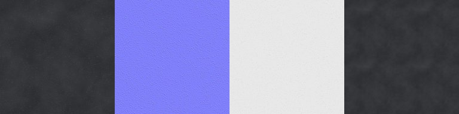
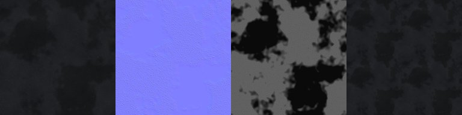
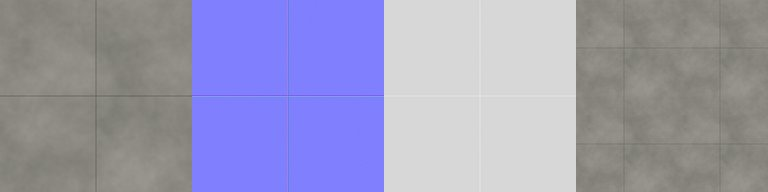
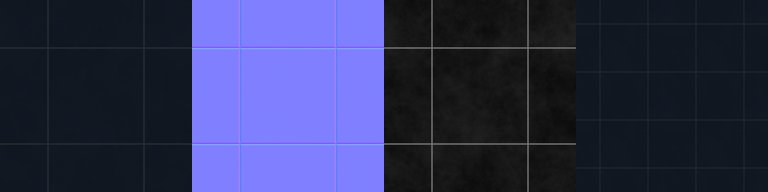
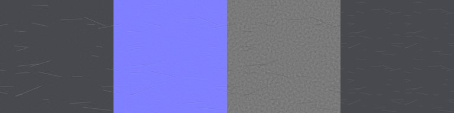

# Material library and road look (VIS-3)

**Status:** VIS-3 road look captured by the leader. **VIS-7.1 wet road values and `NightStyles`: written, not
seen.** The PBR maps are generated and checked here (previews below).

| File | What |
|---|---|
| `roblox/src/ReplicatedStorage/MaterialLibrary.luau` | named materials, `apply` / `save` / `restore`, Studio helper `studioCreateVariants()` |
| `roblox/src/StarterPlayer/StarterPlayerScripts/PattayaRoadLook.client.luau` | client road look: `Lighting.RoadLook` = dry / wet / off |
| `tools/materials/gen_pbr.py` | procedural tileable PBR maps: 1024², PNG, into `build/materials/` (gitignored) |
| `docs/images/materials/*_preview.jpg` | small previews: albedo, normal, roughness, and a 2×2 tiling check |

## Materials
| Name | Material | Color | Reflectance | Transparency | MaterialVariant (if it exists) | PBR maps |
|---|---|---|---|---|---|---|
| DryAsphalt | Asphalt | 62,63,68 | 0 | – | PattayaDryAsphalt (base Asphalt) | asphalt |
| WetAsphalt | SmoothPlastic (Asphalt when the variant exists) | 26,28,34 | 0.25 | – | PattayaWetAsphalt (base Asphalt) | wet_asphalt |
| WetAsphaltJunction | as WetAsphalt (Junction discs only) | 26,28,34 | 0.3 | – | PattayaWetAsphalt | wet_asphalt |
| ConcreteSidewalk | Concrete | 150,148,142 | 0 | – | PattayaConcrete | concrete |
| RoadPaint | SmoothPlastic | 242,242,236 (RoadLook keeps the marking's own colour, slightly brighter) | 0 | – | – | – |
| RoadPaintWet | SmoothPlastic | 250,250,246 (RoadLook: marking colour ×1.1 + 0.06, 15 % toward cyan 205,240,255 for white or amber 255,186,90 for yellow) | 0.4 | – | – | – |
| DarkGlass | Glass | 22,30,42 | 0.3 | 0.1 | PattayaDarkGlass | dark_glass |
| LitWindow | Neon | 255,196,120 | 0 | – | – | – (generic entry; slice panes use `NightStyles` below) |
| PaintedMetal | Metal | 70,72,78 | 0.05 | – | PattayaPaintedMetal | painted_metal (+ metalness) |
| Vegetation | Grass | 58,120,56 | 0 | – | – | – |
| NeonSurface | Neon | 0,223,255 (#00DFFF); pass `{color = magenta #FF2BD6}` | 0 | – | – | – |
| CarPaintMidnight | SmoothPlastic | 18,22,40 | 0.25 | – | – | – |
| CarPaintPearl | SmoothPlastic | 236,236,232 | 0.2 | – | – | – |
| CarPaintRed | SmoothPlastic | 196,24,32 | 0.22 | – | – | – |

Every entry has `surfaceAppearance = {colorMap, normalMap, roughnessMap, metalnessMap}`. The values are `nil` until
the maps are uploaded. `ML.PALETTE` holds the shared colours: cyan, magenta, lamp orange and headlight white.

```lua
local ML = require(game.ReplicatedStorage.MaterialLibrary)
local saved = ML.save(part)        -- Material, Color, Reflectance, Transparency, MaterialVariant
ML.apply(part, "WetAsphalt")       -- opts: {color = c} | {keepColor = true} | {keepTransparency = true}
ML.restore(part, saved)
```
`apply` only writes properties that change. It uses the MaterialVariant only if one with that name exists under
MaterialService (the lookup is cached). On a **MeshPart**, it clones `ReplicatedStorage.MaterialLibraryAssets.<Name>`
(a SurfaceAppearance) into the part, if that template exists and the part has no SurfaceAppearance of its own.

## Night styles (`ML.NightStyles`, VIS-7.1)
The data table PattayaNightLights uses at night for every NightNeon part, keyed by its `Mat` attribute. Full
rationale and the before/after protocol: `docs/NIGHT_LIGHTING.md`.

| Key | Selection | material | colorMul | maxValue | palette |
|---|---|---|---|---|---|
| `LitWindow.small` | `Mat = LitWindow`, pane face ≤ `smallArea` (20 studs²) | Neon | 0.68 | – | – |
| `LitWindow.large` | `Mat = LitWindow`, pane face > 20 studs² | SmoothPlastic | 1.5 | – | – |
| `Shopfront` | `Mat = LitWindow` and name in `ML.SHOPFRONT_NAMES` (ShopGlow, ShopGlass, LobbyGlass) or attribute `Shopfront = true` | Glass | 1.4 | – | – |
| `NeonSurface` | `Mat = NeonSurface` (slice neon strips) | Neon | – | 0.85 | yes |
| `NeonSign` | always-Neon `NeonSign` props without NightNeon (colour only) | (unchanged) | – | 0.85 | yes |
| `_default` | NightNeon without a known `Mat` | Neon | – | – | yes |

- `colorMul` multiplies NightColor's RGB (clamped); `maxValue` caps the HSV value after that; `palette` applies the
  preset's cyan / magenta hue rule first. Order: palette → colorMul → maxValue.
- Legacy ignores the table. By day every NightNeon part is SmoothPlastic + DayColor.
- A new `Mat` with its own night look = one new row here; no script change.

## Road look (`PattayaRoadLook`)
```lua
game.Lighting:SetAttribute("RoadLook", "wet")   -- "dry" | "wet" | "off"; nil = follow LightingPreset
_G.PattayaRoadLook.stats()                       -- client: {mode, registered, styled, queued}
```
- **Which parts** (only under `workspace.PattayaWorld`; the circuit track is not touched):

  | Part name | dry | wet (VIS-7.1) |
  |---|---|---|
  | `Road` (slabs, fill wedges), `Joint` (bend discs) | DryAsphalt: Asphalt 62,63,68, Refl 0 | WetAsphalt: SmoothPlastic 26,28,34, Refl 0.25 |
  | `Junction` (discs) | DryAsphalt | WetAsphaltJunction: Refl 0.3 (reads as a shallow puddle) |
  | `Centre`, `Dash`, `ZebraStripe` | RoadPaint, own hue, value ×1.05 + 0.03 | RoadPaintWet, Refl 0.4, value ×1.1 + 0.06, 15 % cyan (white) / amber (yellow) tint |
  | `Sidewalk` | builder look (untouched) | own colour 15 % darker, material untouched |

  Joint discs stay at the slab value on purpose: they sit mid-road at bends, and a different shine would show as
  spots. Wet looks different from dry without any extra parts, decals or transparent planes: no grain vs Asphalt
  grain, 26 vs 62 grey, sky sheen and sharp SpotLight highlights.
- **Default without the attribute:**
  - MidnightWet → wet
  - Legacy → off
  - every other preset → dry
- **Reversible and live:** each part's builder values (Material, MaterialVariant, Color, Reflectance, Transparency)
  are saved the first time the script sees it; `off` writes them back exactly, and dry ↔ wet ↔ off switch live from
  either attribute (`RoadLook`, or `LightingPreset` when `RoadLook` is nil).
- **Cost:**
  - Parts register on stream-in (`DescendantAdded` on PattayaWorld). At start there is one scan in batches of 5,000
    instances per frame.
  - Parts are styled from a queue, **400 parts per Heartbeat**. The Heartbeat connection exists only while the
    queue has work, so steady driving costs nothing per frame.
  - Changing the look re-queues every registered part whose look differs: about 3,000–6,000 loaded road and
    marking parts plus the sidewalks (roughly as many again), so about 10–30 frames once, then nothing.
  - **Per-frame cost after the queue has drained: none** (no Heartbeat connection; `_G.PattayaRoadLook.stats()`
    shows `heartbeat = false`). Reflectance is a material parameter, not an extra render pass.
  - No parts, planes or lights are created.
- **Measure:** `workspace:SetAttribute("PerfProbe", 10)` (server), at the same spot with `RoadLook = "off"` and
  then `"wet"`. Compare heartbeat p99 and the render CPU/GPU times. Shift+F5 for render FPS with Studio in front.
- **Engine limits:**
  - Roblox has no screen-space reflections (SSR). `Reflectance` mirrors **the sky only** (Creator Docs, BasePart).
  - A wet road therefore shows the highlights of real SpotLights (lamps, headlights) on a smooth surface, a faint sky
    sheen, and a darker colour. It does **not** mirror the neon signs.
  - Fake reflection planes (transparent mirrored copies) were ruled out: they double the draw cost and sort badly
    with transparency.
  - The highlights need `Lighting.Technology = Future` (or the equivalent new lighting setting). ShadowMap/Voxel give
    weaker or no local specular.

## PBR maps (`tools/materials/gen_pbr.py`)
```
python tools/materials/gen_pbr.py                 # all five sets, 1024², seed 7, ~10 s
python tools/materials/gen_pbr.py --only concrete --size 512 --seed 3
```
- **Output** in `build/materials/`: `<name>_albedo.png`, `<name>_normal.png`, `<name>_roughness.png`, and for
  painted_metal also `_metalness.png`.
- **Sets:** asphalt, wet_asphalt (the same stones as asphalt, with puddles: about 25% of the area is smooth, dark
  and flat), concrete (pores, mottling, one expansion joint per tile), dark_glass (2×2 panes with mullions, smudges),
  painted_metal (orange peel, brushed streaks, scratches through to bare metal).
- **Seamless by construction:**
  - FFT-synthesised noise
  - FFT blurs
  - `np.roll` gradients
  - stamped features and scratches that wrap around the edges
  - grooves placed mid-tile

  The script prints a seam ratio per map (edge jump ÷ interior neighbour jump). The last run was 0.1–1.06 for every
  map, and ≤ ~1 means no visible seam.
- **Normal maps** are OpenGL tangent space (+Y green), as Roblox expects. Roughness: white = rough. Metalness:
  white = metal.

Previews (albedo | normal | roughness | 2×2 tiling):







## Upload (the owner or leader; this team cannot upload)
**A. Studio Asset Manager** (no key needed):
1. Run `python tools/materials/gen_pbr.py`.
2. In Studio: View → Asset Manager → **Bulk Import**. Select the PNGs in `build/materials/`, all of them or only the
   sets you want. Each one becomes an Image asset after moderation.
3. Right-click each image → **Copy Asset ID**. Paste the ids into `MaterialLibrary.luau` as
   `"rbxassetid://<id>"`:
   - asphalt → DryAsphalt
   - wet_asphalt → WetAsphalt
   - concrete → ConcreteSidewalk
   - dark_glass → DarkGlass
   - painted_metal → PaintedMetal

   Fill `colorMap`, `normalMap`, `roughnessMap` and `metalnessMap`.
4. Sync the file. Then in **Edit** mode, from the command bar:
   `require(game.ReplicatedStorage.MaterialLibrary).studioCreateVariants()`. This creates the MaterialVariants
   (PattayaDryAsphalt, PattayaWetAsphalt, …) under MaterialService and SurfaceAppearance templates under
   `ReplicatedStorage.MaterialLibraryAssets`. **Save the place.**
5. Play. RoadLook picks up the variants automatically. DryAsphalt and WetAsphalt then both render as Asphalt with the
   custom maps; wet is the low-roughness puddle set.

**B. Open Cloud** (only if the owner creates an API key with `asset:write` for the right creator):
- Endpoint: `POST https://apis.roblox.com/assets/v1/assets`, multipart with `assetType: Image` and the PNG.
- Docs: https://create.roblox.com/docs/cloud/guides/usage-assets
- The key stays in the owner's `.env` and is never committed.
- Not built: say if a small upload script is wanted.

## Limits (Creator Docs, read 2026-10-19)
- **MaterialVariant maps are Plugin Security.** ColorMap, NormalMap, RoughnessMap, MetalnessMap and BaseMaterial
  cannot be set by a running game; the Studio command bar or a plugin can set them. So the variants are made once
  in Studio. At runtime only `BasePart.MaterialVariant` (a string) is set.
  https://create.roblox.com/docs/reference/engine/classes/MaterialVariant
- **Variant base must match.** A variant applies only when its BaseMaterial equals the part's Material. `MaterialService.AsphaltName` and
  the similar override properties are not scriptable, but `MaterialService:SetBaseMaterialOverride()` is (not used:
  it would change every Asphalt part in the game).
  https://create.roblox.com/docs/reference/engine/classes/MaterialService
- **2022 materials.** Mixing legacy materials with MaterialVariants costs performance, so keep
  `MaterialService.Use2022Materials = true`.
- **SurfaceAppearance** works on **MeshParts only**, and its maps are Plugin Security. Roads, sidewalks and
  buildings are plain Parts, so they use the MaterialVariant route.
  https://create.roblox.com/docs/reference/engine/classes/SurfaceAppearance
- **Reflectance** reflects the sky only, and some materials ignore it (BasePart docs). There is no SSR. Neon does
  not take reflections.
- **Texture memory.** Five 1024² sets come to about 16 images. Roblox may downscale them on low-memory devices.
  Check `GraphicsTexture` in PerfProbe after upload.
