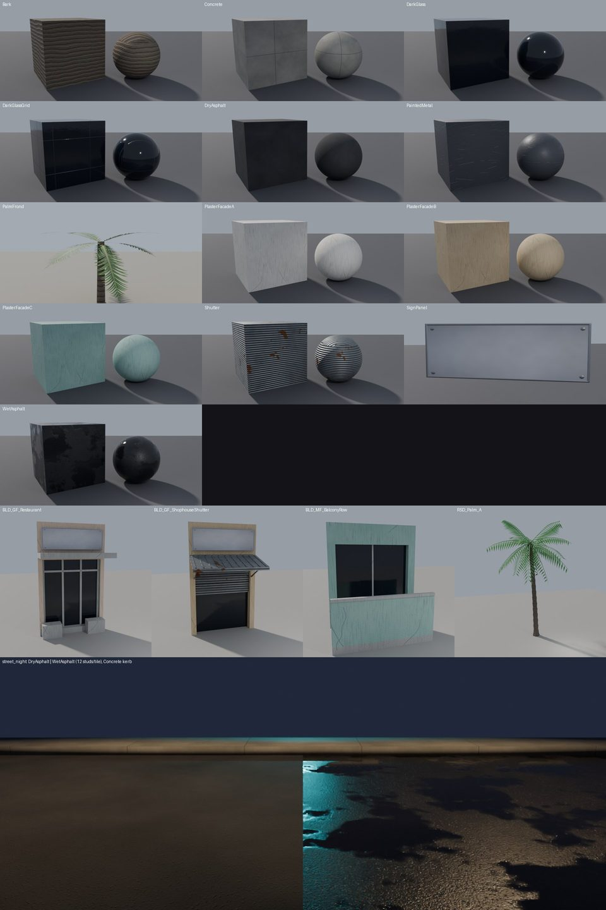

# Material library and road look (VIS-3)

**Status:** VIS-3 road look captured by the leader. **VIS-7.1 wet road values and `NightStyles`: written, not
seen.** **VIS-7.1c PBR maps: 13 sets generated, validated offline and rendered in Blender; not uploaded, not seen in
Studio** (section "PBR maps (VIS-7.1c)").

| File | What |
|---|---|
| `roblox/src/ReplicatedStorage/MaterialLibrary.luau` | named materials, `apply` / `save` / `restore`, Studio helper `studioCreateVariants()` |
| `roblox/src/StarterPlayer/StarterPlayerScripts/PattayaRoadLook.client.luau` | client road look: `Lighting.RoadLook` = dry / wet / off |
| `tools/materials/gen_pbr.py` | procedural PBR sets: `build/materials/<Set>/*.png` (gitignored), manifest, upload list |
| `tools/materials/validate_pbr.py` | offline checks (sizes, seams, normal handedness, alpha, wet vs dry, memory) |
| `tools/materials/make_maps_module.py` | uploaded ids → `MaterialLibraryMaps.luau` ModuleScript |
| `tools/blender/textures/` | `render_sheet.py` (Blender QA renders), `run_sheet.sh` (GPU box), `compose_sheet.py` |
| `docs/images/materials/*_preview.jpg` | small previews: color, normal, roughness, and a 2×2 tiling check |

## Materials
| Name | Material | Color | Reflectance | Transparency | MaterialVariant (if it exists) | PBR maps |
|---|---|---|---|---|---|---|
| DryAsphalt | Asphalt | 62,63,68 | 0 | – | PattayaDryAsphalt (base Asphalt) | DryAsphalt |
| WetAsphalt | SmoothPlastic (Asphalt when the variant exists) | 26,28,34 | 0.25 | – | PattayaWetAsphalt (base Asphalt) | WetAsphalt |
| WetAsphaltJunction | as WetAsphalt (Junction discs only) | 26,28,34 | 0.3 | – | PattayaWetAsphalt | WetAsphalt |
| ConcreteSidewalk | Concrete | 150,148,142 | 0 | – | PattayaConcrete | Concrete |
| RoadPaint | SmoothPlastic | 242,242,236 (RoadLook keeps the marking's own colour, slightly brighter) | 0 | – | – | – |
| RoadPaintWet | SmoothPlastic | 250,250,246 (RoadLook: marking colour ×1.1 + 0.06, 15 % toward cyan 205,240,255 for white or amber 255,186,90 for yellow) | 0.4 | – | – | – |
| DarkGlass | Glass | 22,30,42 | 0.3 | 0.1 | PattayaDarkGlass | DarkGlassGrid (Parts), DarkGlass (MeshParts) |
| LitWindow | Neon | 255,196,120 | 0 | – | – | – (generic entry; slice panes use `NightStyles` below) |
| PaintedMetal | Metal | 70,72,78 | 0.05 | – | PattayaPaintedMetal | PaintedMetal (+ metalness) |
| Vegetation | Grass | 58,120,56 | 0 | – | – | – |
| NeonSurface | Neon | 0,223,255 (#00DFFF); pass `{color = magenta #FF2BD6}` | 0 | – | – | – |
| CarPaintMidnight | SmoothPlastic | 18,22,40 | 0.25 | – | – | – |
| CarPaintPearl | SmoothPlastic | 236,236,232 | 0.2 | – | – | – |
| CarPaintRed | SmoothPlastic | 196,24,32 | 0.22 | – | – | – |

Every entry has `surfaceAppearance = {colorMap, normalMap, roughnessMap, metalnessMap}`. The values are `nil`; since
VIS-7.1c the ids come from `ReplicatedStorage.MaterialLibraryMaps` instead (hand-filled ids still win). Map-only kit
names (PaintedPlaster, RoofConcrete, Bark, SignPanel, Shutter, PalmFrondCard) live in `ML.surfaces`. `ML.PALETTE` holds the shared colours: cyan, magenta, lamp orange and headlight white.

```lua
local ML = require(game.ReplicatedStorage.MaterialLibrary)
local saved = ML.save(part)        -- Material, Color, Reflectance, Transparency, MaterialVariant
ML.apply(part, "WetAsphalt")       -- opts: {color = c} | {keepColor = true} | {keepTransparency = true}
ML.restore(part, saved)
```
`apply` only writes properties that change. It uses the MaterialVariant only if one with that name exists under
MaterialService (the lookup is cached). On a **MeshPart**, it clones `ReplicatedStorage.MaterialLibraryAssets.<Name>`
(a SurfaceAppearance) into the part, if that template exists and the part has no SurfaceAppearance of its own.

## Night styles (`ML.NightStyles`, VIS-7.1)
The data table PattayaNightLights uses at night for every NightNeon part, keyed by its `Mat` attribute. Full
rationale and the before/after protocol: `docs/NIGHT_LIGHTING.md`.

| Key | Selection | material | colorMul | maxValue | palette |
|---|---|---|---|---|---|
| `LitWindow.small` | `Mat = LitWindow`, pane face ≤ `smallArea` (20 studs²) | Neon | 0.68 | – | – |
| `LitWindow.large` | `Mat = LitWindow`, pane face > 20 studs² | SmoothPlastic | 1.5 | – | – |
| `Shopfront` | `Mat = LitWindow` and name in `ML.SHOPFRONT_NAMES` (ShopGlow, ShopGlass, LobbyGlass) or attribute `Shopfront = true` | Glass | 1.4 | – | – |
| `NeonSurface` | `Mat = NeonSurface` (slice neon strips) | Neon | – | 0.85 | yes |
| `NeonSign` | always-Neon `NeonSign` props without NightNeon (colour only) | (unchanged) | – | 0.85 | yes |
| `_default` | NightNeon without a known `Mat` | Neon | – | – | yes |

- `colorMul` multiplies NightColor's RGB (clamped); `maxValue` caps the HSV value after that; `palette` applies the
  preset's cyan / magenta hue rule first. Order: palette → colorMul → maxValue.
- Legacy ignores the table. By day every NightNeon part is SmoothPlastic + DayColor.
- A new `Mat` with its own night look = one new row here; no script change.

## Road look (`PattayaRoadLook`)
```lua
game.Lighting:SetAttribute("RoadLook", "wet")   -- "dry" | "wet" | "off"; nil = follow LightingPreset
_G.PattayaRoadLook.stats()                       -- client: {mode, registered, styled, queued}
```
- **Which parts** (only under `workspace.PattayaWorld`; the circuit track is not touched):

  | Part name | dry | wet (VIS-7.1) |
  |---|---|---|
  | `Road` (slabs, fill wedges), `Joint` (bend discs) | DryAsphalt: Asphalt 62,63,68, Refl 0 | WetAsphalt: SmoothPlastic 26,28,34, Refl 0.25 |
  | `Junction` (discs) | DryAsphalt | WetAsphaltJunction: Refl 0.3 (reads as a shallow puddle) |
  | `Centre`, `Dash`, `ZebraStripe` | RoadPaint, own hue, value ×1.05 + 0.03 | RoadPaintWet, Refl 0.4, value ×1.1 + 0.06, 15 % cyan (white) / amber (yellow) tint |
  | `Sidewalk` | builder look (untouched) | own colour 15 % darker, material untouched |

  Joint discs stay at the slab value on purpose: they sit mid-road at bends, and a different shine would show as
  spots. Wet looks different from dry without any extra parts, decals or transparent planes: no grain vs Asphalt
  grain, 26 vs 62 grey, sky sheen and sharp SpotLight highlights.
- **Default without the attribute:**
  - MidnightWet → wet
  - Legacy → off
  - every other preset → dry
- **Reversible and live:** each part's builder values (Material, MaterialVariant, Color, Reflectance, Transparency)
  are saved the first time the script sees it; `off` writes them back exactly, and dry ↔ wet ↔ off switch live from
  either attribute (`RoadLook`, or `LightingPreset` when `RoadLook` is nil).
- **Cost:**
  - Parts register on stream-in (`DescendantAdded` on PattayaWorld). At start there is one scan in batches of 5,000
    instances per frame.
  - Parts are styled from a queue, **400 parts per Heartbeat**. The Heartbeat connection exists only while the
    queue has work, so steady driving costs nothing per frame.
  - Changing the look re-queues every registered part whose look differs: about 3,000–6,000 loaded road and
    marking parts plus the sidewalks (roughly as many again), so about 10–30 frames once, then nothing.
  - **Per-frame cost after the queue has drained: none** (no Heartbeat connection; `_G.PattayaRoadLook.stats()`
    shows `heartbeat = false`). Reflectance is a material parameter, not an extra render pass.
  - No parts, planes or lights are created.
- **Measure:** `workspace:SetAttribute("PerfProbe", 10)` (server), at the same spot with `RoadLook = "off"` and
  then `"wet"`. Compare heartbeat p99 and the render CPU/GPU times. Shift+F5 for render FPS with Studio in front.
- **Engine limits:**
  - Roblox has no screen-space reflections (SSR). `Reflectance` mirrors **the sky only** (Creator Docs, BasePart).
  - A wet road therefore shows the highlights of real SpotLights (lamps, headlights) on a smooth surface, a faint sky
    sheen, and a darker colour. It does **not** mirror the neon signs.
  - Fake reflection planes (transparent mirrored copies) were ruled out: they double the draw cost and sort badly
    with transparency.
  - The highlights need `Lighting.Technology = Future` (or the equivalent new lighting setting). ShadowMap/Voxel give
    weaker or no local specular.

## PBR maps (VIS-7.1c)

**Status: generated and checked offline, and rendered in Blender on the GPU box. Not uploaded, not seen in Studio.**
Nothing changes in the game until the leader uploads the maps and installs `ReplicatedStorage.MaterialLibraryMaps`.

### Pipeline
| Step | Tool | Output |
|---|---|---|
| 1. generate | `python tools/materials/gen_pbr.py` (~20 s, numpy + pillow, seed 7) | `build/materials/<Set>/{color,normal,roughness[,metalness]}.png` + `height.png` (not uploaded), `manifest.json`, `upload_list.json/.csv`, previews `docs/images/materials/<Set>_preview.jpg` |
| 2. validate | `python tools/materials/validate_pbr.py` (exit 1 on any FAIL) | `build/materials/validation.json` |
| 3. render | `bash tools/blender/textures/run_sheet.sh` then `python tools/blender/textures/compose_sheet.py build/materials/qa/out` | `build/materials/qa/out/*.png`, `build/materials/qa/material_sheet.jpg` (copy: `docs/images/materials/vis71c_material_sheet.jpg`) |
| 4. upload (leader) | Open Cloud or Studio bulk import, one Image asset per row of `upload_list.json` | an id file `{"MP_<Set>_<map>": "<id>"}` |
| 5. module | `python tools/materials/make_maps_module.py <id file>` | `build/materials/MaterialLibraryMaps.luau` |
| 6. install (leader, Studio) | ModuleScript + `studioCreateVariants()` | MaterialVariants + SurfaceAppearance templates, saved with the place |

Everything is procedural (numpy FFT noise, PIL drawing). No downloaded textures, so there are no licences to track.
`run_sheet.sh` sends only `tools/blender/{textures,common}`, the PNG maps and four kit GLBs to its own folder
`/root/robloxrace/vis/team7tex`. It never sends `.env` or keys, and it does not touch the pipeline's `tools/` or `out/`.

### Sets
| Set | Size | Maps | Tiled | Roblox target | Tiling | Content |
|---|---|---|---|---|---|---|
| DryAsphalt | 1024² | C N R | yes | MaterialVariant PattayaDryAsphalt (Asphalt) | 12 studs | binder grain, aggregate chips, wear patches |
| WetAsphalt | 1024² | C N R | yes | MaterialVariant PattayaWetAsphalt (Asphalt) | 12 studs | same stones as dry, about 45 % darker; roughness 0.04 in puddles (29 % of the area), mean 0.25 (dry 0.91) |
| Concrete | 1024² | C N R | yes | variant PattayaConcrete + SA `RoofConcrete` | 8 studs | pores, mottling, one expansion joint per tile |
| PlasterFacadeA / B / C | 512² | C N R | yes | SA `PaintedPlaster` (A, tinted), `_B`, `_C` | 8 studs (kit UV) | stucco grain, repaint patches, vertical water stains, hairline cracks; A warm white (near neutral), B sand, C pastel mint |
| DarkGlass | 512² | C N R | yes | SA `DarkGlass` (kit MP_Glass) | 8 studs | plain pane, smudges, vertical rain streaks (the kit's mullions are geometry) |
| DarkGlassGrid | 1024² | C N R | yes | MaterialVariant PattayaDarkGlass (Glass) | 16 studs | 2×2 panes with mullions, for Part window bands |
| PaintedMetal | 512² | C N R M | yes | variant PattayaPaintedMetal (Metal) + SA | 6 studs / 8 (kit) | orange peel, brushed streaks, scratches to bare metal |
| Shutter | 512² | C N R M | yes | SA `Shutter` | 8 studs: 32 slats = 0.25 stud each | corrugated galvanised slats, dirt in the grooves, rust spots |
| Bark | 512² | C N R | yes | SA `Bark` | 8 studs: 16 rings | palm leaf-scar rings (along X, so they wrap the trunk), vertical fibres, lichen |
| PalmFrond | 512×1024 RGBA | C N R | no | SA `PalmFrondCard`, AlphaMode Transparency | UV 0..1 (`card()`: u across, v base→tip) | rachis + 34 leaflets per side; 37 % coverage; colour bled into the transparent area |
| SignPanel | 512×256 | C N R M | no (frame wraps) | SA `SignPanel` | UV 0..1 on the board front | matte light acrylic, back-light falloff, brushed aluminium frame, 4 screws; the SurfaceGui text sits on top |

C = color (sRGB), N = normal, R = roughness (white = rough), M = metalness (white = metal). Sets without M are
dielectric: leave MetalnessMap empty, which Roblox reads as 0. That saves 10 uploads. Every size is a power of two
and ≤ 1024. Per-set parameters (tones, densities, periods, normal strength) are in `SETS` and the `mat_*`
functions in `gen_pbr.py`.

### UV plan (kit)
- **No change to `tools/blender/common/uv.py`.** `export.py` already box-projects every face at
  `UV_STUDS_PER_TILE = 8` studs per UV tile in world studs. Faces whose primitive set UVs (`uvkeep`) are skipped:
  the sign-board front (`panel()` / `sign_box()`) and the frond cards (`card()`), which keep 0..1.
- I checked the projection: u = +Y on +X faces, −X on +Y faces, +X on top faces. Seen from outside, no face is
  mirrored, so normal maps are not flipped. The render sheet calls the same `box_project()` on its test shapes.
- **Box projection, 8 studs per tile:**
  - walls and accents (Plaster)
  - glass panes (DarkGlass, no baked mullions)
  - metal and shutters (PaintedMetal, Shutter)
  - kerbs and roofs (Concrete)
  - palm trunks (Bark). Box projection on a 7-sided tube shows seams at the 45° corners; with this bark they are
    hard to see (see the render).
- **Per-face 0..1:**
  - sign-board fronts (SignPanel; the board sides fall back to box UVs and land on the frame colour)
  - frond cards (PalmFrond)
- **Parts (roads, sidewalks, PattayaBuilder windows):** MaterialVariant StudsPerTile from `ML.materials`: asphalt 12,
  concrete 8, glass grid 16, metal 6.
- **Texel density:**
  - 512 px per 8 studs = 64 px/stud (facades)
  - 1024 px per 12 studs = 85 px/stud (roads)
- **Kit glTF V flip:** the exporter writes v' = 1 − v and Blender's importer flips it back, so the PNGs are
  authored as seen in Blender (frond base at the image bottom). Studio is assumed to read glTF UVs as written. Not
  verified.

### Validation (last run: ALL CHECKS PASSED)
- **Sizes and modes:** all 42 maps are power of two and ≤ 1024. Color is RGB (RGBA for PalmFrond), normal is RGB,
  roughness and metalness are L.
- **Tileability:**
  - Edge-wrap ratio = mean jump across the wrap edge ÷ mean jump between interior neighbours. 1 means no seam.
  - Tiled sets: 0.1–1.25 on every map, against a limit of 1.5.
  - The first Shutter and Bark versions failed (6.7, 1.53) because a slat groove or ring crease sat on the wrap
    edge. Both are now shifted half a period.
  - 2×2 tiling previews: `docs/images/materials/*_preview.jpg`.
- **Normal format:**
  - **OpenGL (+Y green points up the image).** That is what the Creator Docs texture specifications ask for
    (https://create.roblox.com/docs/art/modeling/texture-specifications, cited in BLENDER_PIPELINE.md). The page
    could not be re-fetched tonight, so this rests on the earlier reading.
  - Proof: each normal map is integrated back to a height field (Fourier Poisson solve) and correlated with the
    height it came from. OpenGL reading: 0.98–1.00 for every set. DirectX reading (green flipped): −1.00 to 0.12.
  - A synthetic dome passes the same test: its upper flank has n_y = +0.22.
  - Decoded |n| deviates from 1 by ≤ 0.002, z > 0 everywhere, and the mean slope is about 0.
- **PalmFrond alpha:**
  - 37 % opaque, and 4.9 % of the pixels are antialiased edge.
  - Transparent pixels carry the bled leaf colour (luminance ratio 1.05 to the opaque pixels), so mip-maps get no
    dark fringe.
- **Wet vs dry:**
  - roughness 0.91 → 0.25
  - mean colour 0.210 → 0.116
  - puddle share 29 %
- **Blender renders** (Cycles, GPU box; Blender's normal-map node is OpenGL, the same as Roblox), in
  `docs/images/materials/vis71c_material_sheet.jpg`:
  - each set on a sphere and an 8-stud cube
  - a sign board, and a 7-card frond crown on a Bark trunk
  - BLD_GF_ShophouseShutter (sand plaster, shutter, sign, glass)
  - BLD_MF_BalconyRow (mint)
  - BLD_GF_Restaurant (warm white tinted salmon, standing in for SurfaceAppearance.Color)
  - RSD_Palm_A (bark)
  - a night street: dry | wet asphalt at 12 studs/tile, with sodium lamps and a cyan light
  - What they show: the grooves read recessed and the slats read raised. Wet asphalt mirrors the lamps and the cyan
    light in its puddles; dry asphalt stays matte. No visible seams on the cubes or the kit walls.



### Budget (mobile)
- **Upload:** 42 PNGs, 14.8 MiB in all.
- **Texture memory if every set is resident (block-compressed estimate, mips included):** about 17.8 MiB.
  - The estimate assumes 1 byte/px for RGBA and normal maps and 0.5 byte/px for the rest.
  - Uncompressed RGBA8 is the upper bound: 105 MiB.
  - Roblox's own GPU format is not documented.
- **Split:**
  - the three 1024² ground sets (DryAsphalt, WetAsphalt, Concrete): 2.7 MiB each
  - DarkGlassGrid: 2.7 MiB
  - PalmFrond: 1.7 MiB
  - each 512² set: 0.4–0.8 MiB
- **Dry and wet are never both shown.** RoadLook switches the variant, so a scene keeps about 15 MiB resident.
- **If mobile memory is tight:**
  - drop DarkGlassGrid to 512 (`--only DarkGlassGrid --size 512`), −2 MiB
  - drop Concrete to 512, −2 MiB
  - Roblox may also downscale on low-memory devices by itself.
  - After the upload, check `GraphicsTexture` in PerfProbe.

### Luau wiring (`MaterialLibrary.luau`)
- **`ReplicatedStorage.MaterialLibraryMaps`** (ModuleScript, optional): `{[Set] = {color, normal, roughness,
  metalness}}`, with ids given as numbers, `"123"` or `"rbxassetid://123"`.
  - `ML.loadMaps()` requires it once inside a pcall.
  - `ML.mapsFor(set)` returns SurfaceMaps, or nil when the set has no colour id.
  - `ML.resolve(def, set)`: hand-filled `surfaceAppearance` ids still win.
- **Entries:**
  - `maps` now names the new sets.
  - DarkGlass has `maps = "DarkGlassGrid"` (the Part variant) and `meshMaps = "DarkGlass"` (the MeshPart template).
  - No other entry value changed: wet and dry asphalt, NightStyles and the colours are untouched.
- **`ML.surfaces`** holds map-only names for the kit MeshPart `Mat` values that have no `ML.materials` entry:
  `PaintedPlaster` (A + variants `_B` / `_C` via the part attribute `MapVariant`, `tint = true`), `RoofConcrete`,
  `Bark`, `SignPanel`, `Shutter` and `PalmFrondCard` (AlphaMode Transparency). For these names, `apply()` only
  clones the SurfaceAppearance template. It never touches Material, Color or Reflectance.
- **Tint.** For `tint` surfaces, the clone gets `SurfaceAppearance.Color = part.Color`, which keeps the per-building
  palette on the near-neutral plaster. If that property cannot be set, the clone is dropped, so a wall keeps its
  palette colour instead of turning white.
- **`studioCreateVariants()`** (Edit-mode command bar) builds the MaterialVariants and every SurfaceAppearance
  template from the module. It sets AlphaMode to Overlay (Transparency for the frond).
- **Fallback (today):**
  - No module, or no colour id for a set: nothing is created for that set, and `apply()` finds no template.
  - Map-only names: `apply()` returns without changing anything. Before this change it raised "unknown material"
    inside the builders' pcall, with the same result.
  - Existing entries behave exactly as before.
  - Covered by a mock test run with the luau CLI: fallback, template and variant creation, tint, MapVariant, the
    no-`SurfaceAppearance.Color` path, and the wet/dry values. `luau-compile` passes.

### Upload and install (leader)
1. `python tools/materials/gen_pbr.py`
2. `python tools/materials/validate_pbr.py`. It must print `ALL CHECKS PASSED`.
3. Upload every row of `build/materials/upload_list.json`, 42 PNGs. Display name = `name` (`MP_<Set>_<map>`).
   - **Open Cloud:** `POST https://apis.roblox.com/assets/v1/assets`, multipart.
     - `request` = `{"assetType": "Image", "displayName": name, "description": "MIDNIGHT PATTAYA PBR map", "creationContext": {"creator": {...}}}`
     - `fileContent` = the PNG (`image/png`).
     - Poll the returned operation for the `assetId`.
     - Check in the docs whether your key's API accepts `Image` or wants `Decal`. SurfaceAppearance and
       MaterialVariant need the **image** id, not a decal id.
   - **Or Studio:** Asset Manager → Bulk Import the PNGs, then Copy Asset ID for each image.
4. Write the ids as `{"MP_DryAsphalt_color": "123", ...}` into `build/materials/upload_ids.json`. Then run
   `python tools/materials/make_maps_module.py build/materials/upload_ids.json`. It reports missing ids.
5. In Studio, **Edit** mode:
   - Insert a ModuleScript `ReplicatedStorage.MaterialLibraryMaps` with the content of
     `build/materials/MaterialLibraryMaps.luau`.
   - Run `require(game.ReplicatedStorage.MaterialLibrary).studioCreateVariants()` in the command bar.
   - Check the printed list, then **save the place**.
6. Rebuild or refresh the kit (VisMeshBuilder calls `apply` per MeshPart `Mat`) and the roads (RoadLook). Rollback:
   delete `MaterialService.Pattaya*`, `ReplicatedStorage.MaterialLibraryAssets` and `MaterialLibraryMaps`. Parts keep
   their builder look, and `MaterialLibrarySA` clones go away on the next `apply` (or rebuild).

### Unverified / open
- Nothing has been seen in Studio:
  - SurfaceAppearance on kit MeshParts whose Material is Glass or SmoothPlastic
  - `SurfaceAppearance.Color` tint support
  - frond alpha sorting
  - the V orientation after the importer
- **Shutter maps don't reach the shutters yet.** The kit's MP_Shutter maps to Mat `PaintedMetal` in
  `tools/mapgen/config/vis_slice.json` (not this team's file). To use the Shutter set, change that mapping to
  `Shutter`.
- **Bark maps don't reach the trunks yet.** VisMeshBuilder sets palm trunks to `Material.Wood` and does not call the
  library for them. To use the Bark set, add `styleWithLibrary(mp, "Bark")` (not this team's file).
- **PalmFrond has no geometry to use it yet.** The VIS-7.1b palms use geometry leaflets, and box-projected UVs on
  those must not get the frond card. PalmFrond is ready for a card LOD.

## Limits (Creator Docs, read 2026-10-19)
- **MaterialVariant maps are Plugin Security.** ColorMap, NormalMap, RoughnessMap, MetalnessMap and BaseMaterial
  cannot be set by a running game; the Studio command bar or a plugin can set them. So the variants are made once
  in Studio. At runtime only `BasePart.MaterialVariant` (a string) is set.
  https://create.roblox.com/docs/reference/engine/classes/MaterialVariant
- **Variant base must match.** A variant applies only when its BaseMaterial equals the part's Material. `MaterialService.AsphaltName` and
  the similar override properties are not scriptable, but `MaterialService:SetBaseMaterialOverride()` is (not used:
  it would change every Asphalt part in the game).
  https://create.roblox.com/docs/reference/engine/classes/MaterialService
- **2022 materials.** Mixing legacy materials with MaterialVariants costs performance, so keep
  `MaterialService.Use2022Materials = true`.
- **SurfaceAppearance** works on **MeshParts only**, and its maps are Plugin Security. Roads, sidewalks and
  buildings are plain Parts, so they use the MaterialVariant route.
  https://create.roblox.com/docs/reference/engine/classes/SurfaceAppearance
- **Reflectance** reflects the sky only, and some materials ignore it (BasePart docs). There is no SSR. Neon does
  not take reflections.
- **Texture memory.** See "Budget (mobile)" above: about 18 MiB compressed for all 13 sets. Roblox may downscale
  them on low-memory devices. Check `GraphicsTexture` in PerfProbe after upload.
