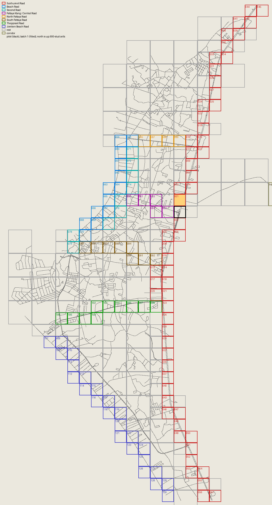

# Road B for the whole city: the batch rollout

**Status: OFFLINE design and data.** team20, 2026-10-22: branch `team20/road-city` (merged into main as `af31641`),
then branch `team20/road-city2` (b003 builds second, option B by default from b003 on, the parts numbers and the
frame-time measurement plan). Nothing in this document has been built in Studio; b001 waits for the owner's backup.
The leader installs a batch only after the owner's go-ahead and a fresh place backup. Every number marked "offline"
comes from the static model in `tools/roadvis/city_qa.py` (collision tops, the terrain height field, buildings as
walls). It is not physics.

## Owner summary

- The clean road of the pilot (Road B) and the ground at road level (+0.9) can now go out to the whole city, batch by
  batch. A batch is one 600 x 600-stud square on the pilot's grid (in quiet areas a 2 x 2 or 2 x 1 block of them).
- The plan has **262 batches**. Main roads go first: Sukhumvit both ways from the pilot, then Beach Road, Second Road,
  Pattaya Klang, North Pattaya Road, South Pattaya Road, Thepprasit and Jomtien Beach Road. Then the rest of the city,
  then the Bira corridor.
- **Build order:** b001, then **b003** (Sukhumvit north of b001: it finishes the roads at b001's north edge, the
  owner's second screenshot spot), then b002 and the rest as before. The ids stay.
- Every batch can be undone on its own, in two calls: `RG.Remove("<id>")` puts the terrain back exactly and
  `RV.Remove("<id>")` puts every old road part back. The batch built last is undone first.
- **Batch 1 (b001)** is Sukhumvit just north of the pilot (world x 24220..24820, z 50..650). It is not installed yet
  (it waits for the owner's backup), and its data is frozen: byte for byte what the leader checked, with a test that
  keeps it so. Offline it has no lane hole in the box away from its open edges (0 of 2,807 lane samples), no drop and
  no wall on a 1-stud grid over the whole box, and every road edge sits 0.10..0.12 studs above the ground. All 72
  off-road runs leave the road and come back with no drop. It adds 1,057 parts and moves 539 old parts out (net +518).
- **b003** (second): offline 0 lane holes in its core (2,920 lane samples), no drop and no wall on the 1-stud grid, road
  edges at most 0.25 above the ground, a clean seam with b001, and all 240 off-road runs come back with no drop. It adds
  1,289 parts and moves 390 (net +899). Its data, install bundle and the expected Studio lines are in section 6.
- **Option B** (no invisible support wedges where the ground is raised to +0.9) is the default from b003 on. Nothing
  visible changes (checked piece by piece); over the whole plan the supports go from 52,159 to 462 parts.
- **City parts, the hard part.** With B, **Sukhumvit (b001..b057) adds a net +27,987** parts (without B +32,850):
  that fits in the room of about +32,074 under the QA warning line. The main roads add +56,702 and the whole city in
  lean +154,651. Without asset uploads, the single marking ideas of section 3 save 322 to 3,402 parts each on
  Sukhumvit after b001, and the look-keeping set 5,163 together; each changes the look and needs the owner's choice.
  Section 3 also has a measurement plan (about 1.5 hours in Studio) so the owner can set a higher line from frame times
  and memory.
- **The owner decides:** the go for batch 1 and then b003; the marking ideas; the parts path past Sukhumvit; lean or
  full sidewalks; plain Ground or Pavement near buildings; what to do with street poles that stand on narrow median
  islands (2 in batch 1, 42 in the city). See section 9.

## 1. How a batch works

### 1.1 The grid and the directions

- Cells are 600 x 600 studs. The grid starts at the pilot's corner, world (24220, 650). The pilot is cell (0, 0).
- World x grows to the east. **World z grows to the south**: North Pattaya Road is near z -2,500, South Pattaya Road
  near z +2,900. So batch 1 (z 50..650) is **north** of the pilot (z 650..1250). They share the edge z = 650.
- A box is half-open: x0 <= x < x1 and z0 <= z < z1. A point on a shared edge belongs to exactly one batch.

### 1.2 What changed in the tools

| Piece | What it does now |
|---|---|
| `tools/roadvis/city.py` | The city model: all 65,873 old road-layer parts, the 1,822 pilot parts, the city-wide road chains. Per batch: the ideal Road B, who owns which part, frontier pieces, the pilot-band completion, option B. The batch plan (`SECOND`: b003 builds second). `FROZEN`: the settings b001 was shipped with, so its data stays byte for byte whatever the defaults. The marking options (section 3). |
| `tools/roadvis/city_export.py` | Road B data per batch: `PattayaDataRoadVis_<id>` (manifest + cell modules of at most 600 parts, the replace keys, the probe samples with their offline expectation). |
| `tools/roadvis/city_ground.py` | Ground data per batch, `PattayaDataRoadGround_<id>`, and the never-raise data, `PattayaDataRoadGroundNoRaise`. |
| `tools/roadvis/city_qa.py`, `city_batch.py`, `city_view.py` | Offline QA, the Studio drive list, previews. |
| `tools/roadvis/city_cli.py` | `plan` (all batches and their numbers), `batch <id> [--art]` (data, QA, drives, previews), `bundle <id> [<id> ...] [--no-builders] [--rv-only]` (the install bundle; `--no-builders` when the builders are installed already, as for b003; `--rv-only` for Road B data alone, e.g. the measurement copy of section 3), `map [--art]` (the plan map). |
| `PattayaRoadVisBuilder.luau` | A batch id selects the city mode: `RV.Plan("b001")`, `Build`, `MoveReplaced`, `Probe`, `Remove`, plus `RV.Status()` and `RV.Leftovers()`. |
| `PattayaRoadGroundBuilder.luau` | The same for the ground: `RG.Plan("b001")`, `Build`, `Probe`, `Remove`, plus `RG.Adopt`, `RG.Status()`, `RG.Leftovers()`. |

**The pilot is not migrated.** Without an id every call works on the pilot exactly as before (`RoadVisPilot`,
`PattayaDataRoadVis`, `RoadVisBackup`). The pilot export is byte for byte the same (a test checks it).

Names in the place:

| | Pilot (unchanged) | City batch `<id>` |
|---|---|---|
| Road B parts | `workspace.PattayaWorld.RoadVisPilot` | `workspace.PattayaWorld.RoadVisCity.<id>` (one Atomic Model `Cell_<cx>_<cz>` per 256-stud cell) |
| Road B data | `ServerStorage.PattayaDataRoadVis` | `ServerStorage.PattayaDataRoadVis_<id>` |
| Moved old parts | `ServerStorage.RoadVisBackup` | `ServerStorage.RoadVisCityBackup.<id>` |
| Ground data | none (raised by hand on 2026-10-22) | `ServerStorage.PattayaDataRoadGround_<id>` and `ServerStorage.PattayaDataRoadGroundNoRaise` |
| Ground undo | `ServerStorage.RoadGroundBackup_20261022` | `ServerStorage.RoadGroundCity.<id>` (TerrainRegion `Voxels` + checksums) |

Every city part carries `RoadVisBatch = <id>`. A frontier piece also carries `RoadVisFor = <the batch that replaces
it>`.

### 1.3 Who owns a part

1. **Old road parts** (the containers and names of the pilot: `WideChunks` / `Chunks` Road, Sidewalk, Dash, Centre;
   `WideJunctions` / `Junctions` Junction, Joint; `ApronChunks` Road and Sidewalk; `FurnitureChunks` ZebraStripe).
   A batch takes a part when the centre of its footprint is in the box, or when the part overlaps the box by 1 stud²
   or more. The first batch built over a part takes it. Later batches never see it again.
2. **Frontier pieces.** A taken part can stick out of the box. Its outside piece is rebuilt at once, same footprint,
   as Road B asphalt (top 1.0) or sidewalk (top 1.6). It is cut along the grid and tagged with the batch that owns
   that ground. When that batch is built, it takes the frontier piece like an old part. So the road outside a box never
   gets a hole.
3. **Pilot parts** that stick out of the pilot box into a batch box are taken the same way. Their part inside the pilot
   box is rebuilt exactly.
4. **The pilot seam band.** Near its edge the pilot tapered into the old road and left out some asphalt and sidewalk
   (within 40 studs of the edge). The batch next to that edge builds them ("pilot-band completion"). For batch 1 this is
   164.5 studs² of asphalt and 126.8 studs² of sidewalk.
5. **City batch to city batch.** Both batches compute the ideal road from the same city-wide road chains (so the lane
   dashes keep one rhythm) and cut it on the shared edge. Every vertex on the edge stays on the edge. The two sides meet
   with no gap and no overlap. Nothing waits for a later batch.
6. **Invisible wheel support** (`RoadSupport`) follows the pilot's rule: where a removed old part carried a wheel within
   2 studs of the new asphalt and Road B puts no kerb there. **Option B (the default from b003 on):** a support
   triangle is left out when every voxel column under it is raised to the plateau (+0.9) by the batch's own ground
   data, the pilot's raise or an earlier batch's ground. A wheel there meets the ground 0.1 below the asphalt, so the
   old part the support stood in for leaves no drop. Supports stay where the ground is not at the plateau: on the
   20-stud ramp at an open edge, near never-raise zones, and in the corridor (no ground there). It is done in the
   generator; the builders did not change. b001 keeps its 9 supports (its data is frozen).
7. **Studio's float32 positions.** A part whose overlap is within 0.15 stud² of the 1-stud² line, or whose centre is
   within 0.15 studs of a box edge, gets an optional key: MoveReplaced accepts it moved or not. Every triangle is also
   written so that the builder splits it into the same two WedgeParts in float32 as offline (no near-tie between its
   two longest sides, no side within 0.004 studs of the builder's 0.05 skip). Without this, a later batch could miss a
   frontier piece by its position.

### 1.4 Build order and undo

- The data of batch N is made for one state: batches 1..N-1 built, the later ones not. `Plan`, `Build` and
  `MoveReplaced` check this (manifest `builtBefore`) and refuse otherwise. Build in plan order: **b001, b003, b002,
  b004, b005, ...** (b003 moved up on 2026-10-22; ids are kept, so the plan position and the id differ for b002 and
  b003 only).
- The ground builder has no order check of its own: its max rule gives the same heights in any order, and its
  registry seq is the order of the builds. Build the ground in plan order too, so `RG.Remove` stays last in, first out
  (offline, the luau test builds b003's ground after b001's and checks both undo exactly).
- **Last in, first out.** `RV.Remove(id)` refuses while a later neighbour is built, or while a later batch's backup
  holds this batch's frontier pieces. `RG.Remove(id)` refuses while a later raised box overlaps this one, or when the
  terrain in the box changed since the build (checksum). `RV.Remove()` (the pilot) refuses while a city batch next to the
  pilot is built.
- Removing a batch gives back exactly the state before it: every moved part goes back to its parent with its CFrame;
  the terrain comes back from its TerrainRegion and is checked against the checksum taken before the build.
- `RV.Leftovers()` and `RG.Leftovers()` list anything left behind after everything is removed.

### 1.5 The ground per batch

- **Height.** The box, widened to the 4-stud voxel grid, is raised to **+0.9**. Voxel layer y -4..0 gets occupancy
  0.725 over the full layer below. This is the leader's measured model: surface = centre of the top filled voxel
  + 4 x its occupancy. Build uses WriteVoxels with explicit occupancies, never FillBlock (FillBlock overshoots).
- **Ramp.** A 20-stud ramp falls back to -2 around the box.
- **Neighbours merge.** Build writes a column only where the data asks for more than what is there. A raised neighbour
  is never lowered. Two raised boxes merge with no ramp between them. The ramp shows only at the outer edge of the
  raised area. Batch 1 merges with the pilot's hand raise on z = 650.
- **Check first.** Every data column must be land as PattayaBuilder made it (layer -2 Ground full, layers -1 and 0 Air)
  or ground this builder raised. Anything else (water, sand, another builder's terrain) makes Plan say NOT READY, and
  Build writes nothing.
- **Never-raise zones** (data `PattayaDataRoadGroundNoRaise`, 6,019 runs of voxel columns, 93 KB): the sea and beach
  sand cells of the city terrain (8,802,305 and 89,536 voxel columns), every column outside the city terrain frame (the
  coast islands Ko Lan, Ko Sak and Ko Krok lie outside it; their boxes are kept with a 16-stud margin as a second net),
  and three landmarks with low parts that a raise would bury (Bali Hai pier, the Pattaya City sign, the Floating Market;
  8-stud margin). The plan never asks for a column there, near such a zone the plateau ramps down instead, and Build
  refuses a write there all the same.
- **Material.** Ground everywhere by default. Pavement near buildings is ready as an option:
  `RG.Build(id, {pavement = true})` (16,012 of the 25,740 columns of batch 1 would be Pavement).
- **Undo.** Build first copies the voxel box (layers -2..0) into `ServerStorage.RoadGroundCity.<id>` with checksums
  before and after. `RG.Remove(id)` pastes it back and checks the checksum.
- **The pilot's hand raise** is registered once: `RG.Adopt("pilot", ServerStorage.RoadGroundBackup_20261022,
  Vector3.new(6048, -3, 156))`. It copies the backup into the registry as seq 0. The terrain does not change.
- The ground adds no instance to workspace. Each batch keeps one TerrainRegion in ServerStorage.

## 2. The batch plan

`art/roadcity/plan_map_city.png`: every batch box coloured by its road group, with its number. The pilot is the black
box, batch 1 the filled one. North is up.

**Order:**

1. b001: the owner's batch 1, Sukhumvit north of the pilot.
2. b003, the box north of b001 (world x 24220..24820, z -550..50). It finishes the roads at b001's north edge, the
   owner's second screenshot spot (the leader's order of 2026-10-22). It keeps its id (section 6).
3. The rest of Sukhumvit: every cell with at least 20 studs of Sukhumvit, nearest to the pilot first, north and south
   in turn (b002, b004, b005, ...). This is the worst road class today (97.9 % of its edges are drops).
4. Beach Road, Second Road, Pattaya Klang / Central Road, North Pattaya Road, South Pattaya Road, Thepprasit Road,
   Jomtien Beach Road. Each road starts at the cell nearest to what is built and grows from there.
5. The rest of the city terrain frame, in 2 x 2 blocks of cells. A block with more than 2,400 old parts, or one that
   touches a built cell, is split into 2 x 1 rows or single cells. The block nearest to what is built goes first, so
   the built area grows without islands.
6. The Bira corridor east of the city terrain frame: Road B only. The ground is raised only where a corridor box
   reaches into the frame (5,588 voxel columns in all 23 corridor batches).

**Per road group (lean with option B, offline counts):**

| # | Group | Batches | Cells | Parts added | Old parts moved | Net | Net without B | Largest Atomic cell | Frontier pieces built | Ground columns | Poles on islands |
|---|---|---|---|---|---|---|---|---|---|---|---|
| 1 | Sukhumvit Road (b001..b057) | 57 | 57 | 43,437 | 15,450 | +27,987 | +32,850 | 585 | 5,747 | 1,463,183 | 16 |
| 2 | Beach Road (b058..b070) | 13 | 13 | 9,371 | 5,648 | +3,723 | +4,199 | 472 | 1,162 | 266,792 | 0 |
| 3 | Second Road (b071..b079) | 9 | 9 | 7,540 | 3,625 | +3,915 | +5,193 | 499 | 709 | 223,505 | 0 |
| 4 | Pattaya Klang / Central Road (b080..b084) | 5 | 5 | 6,522 | 2,827 | +3,695 | +4,586 | 477 | 898 | 128,700 | 4 |
| 5 | North Pattaya Road (b085..b088) | 4 | 4 | 2,662 | 1,020 | +1,642 | +1,950 | 292 | 159 | 102,960 | 0 |
| 6 | South Pattaya Road (b089..b096) | 8 | 8 | 10,503 | 4,478 | +6,025 | +8,360 | 589 | 1,010 | 205,920 | 9 |
| 7 | Thepprasit Road (b097..b106) | 10 | 10 | 9,062 | 2,742 | +6,320 | +8,126 | 446 | 710 | 257,400 | 1 |
| 8 | Jomtien Beach Road (b107..b130) | 24 | 24 | 8,418 | 5,023 | +3,395 | +3,987 | 368 | 1,083 | 427,193 | 2 |
| 9 | rest (b131..b239) | 109 | 276 | 131,095 | 38,572 | +92,523 | +131,671 | 554 | 4,824 | 6,138,149 | 10 |
| 10 | corridor (b240..b262) | 23 | 92 | 8,219 | 2,793 | +5,426 | +5,426 | 280 | 860 | 5,588 | 0 |
| | **City** | **262** | **498** | **236,829** | **82,178** | **+154,651** | +206,348 | **589** | **17,162** | **9,219,390** | **42** |

**Running total of net parts (lean with B):** after Sukhumvit Road: +27,987; after Beach Road: +31,710; after Second
Road: +35,625; after Pattaya Klang / Central Road: +39,320; after North Pattaya Road: +40,962; after South Pattaya Road:
+46,987; after Thepprasit Road: +53,307; after Jomtien Beach Road: +56,702; after rest: +149,225; after corridor:
+154,651.

At the end every one of the 65,873 old road-layer parts has been taken by a batch. Frontier pieces still standing at the
end: 202 (their target box has no batch). The 1,822 pilot parts: 127 are taken by city batches next to the pilot.
Triangle rows nudged by 0.01..0.03 stud for the float32 split: 629; slivers dropped: 1.

The 23 corridor batches raise 5,588 ground columns, where their boxes reach into the city terrain frame; outside the
frame nothing is raised.

Net instances in workspace for a batch = its net parts + its Atomic cell Models + 1 Folder (all batches: +157,469). The
moved old parts go to ServerStorage with one Folder per source parent.

**What moving b003 up and option B changed in the plan** (offline, every batch compared with the first run of
2026-10-22): the order is the same except b003 and b002 swapped; every batch moves the same old parts (equal in all 262
batches) and builds the same visible pieces (every kind but the supports equal in every batch); only the invisible
supports went from 52,159 to 462 parts (b001 keeps its 9).

The whole list with every number is Appendix A; `build/roadcity/plan_batches.csv` and `plan.json` have more columns.

## 3. Budget

**The place today.** The QA runner's reference is 126,886 BaseParts in workspace (`PattayaQARunner.PART_REFS`, the sum
of its folders) and its warning line is **160,000** (`TOTAL_PARTS_WARN`). Studio counted about 184,000 `PattayaWorld`
descendants before the shoulder pilot (docs/STREAMING_ARCHITECTURE.md). The pilot added a net +1,040 parts (1,822 built,
782 moved to ServerStorage). Moved parts leave workspace, so the QA total counts only the net; they stay in the place
file until their backup is deleted.

**Room under the warning line:** 160,000 - 126,886 - 1,040 = about **32,074** net parts, if the reference is close to
the real count (the leader's QA run gives the real number).

**Option B is the default from b003 on** (section 1.3, rule 6). Measured over the whole plan (offline): the invisible
supports go from 52,159 to 462 parts; nothing visible changes (section 2). **Sukhumvit (b001..b057): net +27,987**
(without B +32,850). The main roads (groups 1-8): +56,702 (without B +69,251). The whole city: +154,651 (without B
+206,348). Per group: section 2.

| Variant | What it builds | Parts added | Moved | Net in workspace | Workspace estimate (126,886 + pilot 1,040 + net) | vs 160,000 | Net without B |
|---|---|---|---|---|---|---|---|
| lean (default) | sidewalks and centre lines only on main roads (trunk, secondary, tertiary and their links; the graph has no primary roads) | 236,829 | 82,178 | +154,651 | 282,577 | OVER by 122,577 | +206,348 |
| full | sidewalks and centre lines on every road, as the pilot | 394,743 | 82,178 | +312,565 | 440,491 | OVER by 280,491 | +312,661 |
| lean2 | lean, with coarser collision outlines (simplify 0.5 instead of 0.25) | 197,055 | 82,178 | +114,877 | 242,803 | OVER by 82,803 | +166,477 |

**Where the lean parts go** (with B, offline counts, all batches): asphalt 81,526 (34 %), sidewalk 69,161 (29 %),
kerb strips 15,681 (7 %), edge lines 15,442 (7 %), frontier asphalt 14,533 (6 %), lane dashes 13,695 (6 %), island
8,170 (3 %), centre lines 4,517 (2 %), grass 3,933 (2 %), stop lines 3,618 (2 %), zebra stripes 3,462 (1 %), frontier
sidewalk 2,629 (1 %), invisible support 462 (under 1 %).

### Fewer marking and kerb parts without uploads (measured offline)

The owner has not approved the mesh uploads (about 2,600 assets), so markings and kerb strips stay Parts. Each idea
below was measured with the generator's own code over every batch (`city.ideal` + `city.batch_segs`, the same code the
plan runs; the base count equals the plan's markings in every batch). b001 is left out: its data is frozen and keeps the
shipped markings, like the pilot. "Saves" counts Parts. None of these is the default; each needs the owner's choice. OSM
gives no dash pattern for these roads (19 ways in the raw extracts carry `lane_markings` at all), so "longer dashes only
where real markings allow" cannot be checked from the data; the old roads of the wide world use 8 / 32 today.

Sukhumvit b003..b057 has 14,199 marking and kerb-strip parts today in the plan: lane dashes 6,817, kerb strips 2,230,
edge lines 2,165, zebra bars 1,938, centre lines 630, stop lines 419.

| Idea | What it looks like | Saves on Sukhumvit (b003..b057) | Saves on the main roads | Saves in the city |
|---|---|---|---|---|
| 1. Continuous lines and kerb strips simplified at 0.6 stud instead of 0.25 / 0.3 (merges near-collinear pieces) | straight stretches unchanged; on curves and corner radii fewer, longer straight pieces, up to 0.6 stud (about 16 cm) off the true curve; a kerb strip can stand that far off the kerb edge mid-chord; seen only up close at tight corners; no seam with b001 | -1,115 | -3,105 | -8,750 |
| 2. The same at 1.0 stud | corner radii read as polygons; a strip can leave a 1-stud sliver or overhang the kerb at a tight corner: visible from a car at junctions | -1,652 | -4,722 | -12,983 |
| 3. No white edge line along kerbed edges | the kerb strip and the kerb face still mark the edge; main roads look plainer; the edge line ends at the seam with b001 | -2,165 | -5,974 | -15,375 |
| 4. No light kerb-stone strip on the sidewalk edge | the sidewalk meets the asphalt in its own colour; the 0.6 kerb step stays; the strip ends at the seam with b001 | -2,230 | -6,070 | -15,636 |
| 5. Lane dashes 10 on / 20 off (period 30) instead of 8 / 12 (period 20) | about 2.7 m dashes with 5.4 m gaps (at about 0.27 m per stud: a lane is 13 studs, 3.5 m); the rhythm changes at the seam with b001 | -2,215 | -3,354 | -4,428 |
| 6. Lane dashes 10 on / 30 off (period 40) | about 2.7 m dashes with 8.1 m gaps: the period of the old roads all over the map today (8 / 32, `pattaya_wide.json` `dash_gap_studs` 32); the rhythm changes at the seam with b001 | -3,402 | -5,164 | -6,804 |
| 7. Zebra bars 3 wide with 3 gaps instead of 2 / 2 (fewer pieces per zebra) | about a third fewer, wider bars (0.8 m instead of 0.55 m); still a zebra; differs from b001. As measured, the 1-stud clearance around the bars leaves short bits of edge line in the 3-stud gaps (counted here); with this idea the clearance would go to 1.5 | -632 | -945 | -1,093 |
| 8. One yellow centre line instead of the double line | a single yellow line (0.45 wide) on the centre where today there are two; differs from b001 | -322 | -775 | -2,044 |
| Measured together: 1 + 6 + 7 (the look kept as far as possible) | as 1, 6 and 7 | -5,163 | -9,225 | -16,650 |
| Measured together: 1 + 3 + 6 + 7 + 8 | as 1, 3, 6, 7 and 8: plainer main roads | -7,106 | -14,473 | -29,640 |

Notes: two triangle rows that together form a rectangle could be one Part instead of up to four WedgeParts; measured on
the written lean data, no such pair exists (0 saved). Ideas 1 and 2 do not show at the seam with b001; ideas 3 to 8
change the look from b003 on, so at z = 50 (b001) and at the pilot the old pattern meets the new one. A change that
shows at a seam is best started at a natural edge (for example a new road group) or applied to b001 and the pilot as
well (that needs a new b001 and a pilot rebuild, outside this task).

### Other ways to bring it down

| # | Option | Saves (whole plan) | Saves (main roads, groups 1-8) | Saves (Sukhumvit) | Cost / condition |
|---|---|---|---|---|---|
| A | **Road B only on the main roads** (130 batches); the ground at +0.9 on every city batch (no parts) | -97,949 (the rest and the corridor keep the old road) | 0 | 0 | the sois keep today's look and overlaps; the ground still removes their trench (road edge 0.1 above the ground); needs a ground-only QA mode in `city_batch` (small) |
| C | **Markings and kerb strips as one visual mesh per Atomic cell** (from b003 on) | -53,492 (56,041 marks, +2,549 meshes) | -27,265 | -13,813 | the meshes must be uploaded as assets (about 2,549; not approved); an EditableMesh made in Edit mode is not saved |
| D | **lean2: coarser collision outlines** (0.5 instead of 0.25) | -39,774 (measured run) | -13,432 | -5,439 | road edges up to 0.5 stud less exact |

**What fits under the line** (offline counts; the room is about 32,074):

| Build | Net parts | Under the line? |
|---|---|---|
| Sukhumvit (b001..b057), lean with B | +27,987 | fits |
| the same with the look-keeping marking set (1 + 6 + 7) | +22,824 | fits |
| the same with the stronger marking set (1 + 3 + 6 + 7 + 8) | +20,881 | fits |
| the main roads (groups 1-8) with B | +56,702 | over |
| the main roads with B and the stronger marking set | +42,229 | over |
| the main roads with B and C (mesh upload, not approved) | +29,437 | fits |
| the main roads in lean2 with B | +43,270 | over |
| the whole city in lean with B | +154,651 | over |

**Recommendation:** keep option B (done, no visible change). Build Sukhumvit in lean with B (it fits), and take the
look-keeping marking set (ideas 1, 6, 7) if the owner accepts the longer dashes and the wider zebra bars. The main
roads beyond Sukhumvit need the mesh path (C, uploads) or a higher line set from the measurement below; the stronger
marking set alone still leaves them at +42,229. Raise the ground on every city batch: it costs no parts. The owner
decides.

**Atomic cells and streaming.** Each batch builds about 10 Atomic `Cell_*` Models (2,556 in all); the largest holds 589
parts. The data caps a module at 600 parts and the streaming layout b cap is 1,500 per road cell
(docs/STREAMING_ARCHITECTURE.md), so every cell is well under it. The old chunk Models lose parts. The largest net
change within one 1,280-stud streaming radius (batch centres around world x 20020, z 3650) is +16,403 parts; with
Sukhumvit alone built it is +4,531 (around x 23920, z 3350). About 19,000 instances stream in after a teleport today
(estimate from counts; not measured).

**QA runner caps.** `PattayaQARunner` checks parts per top folder and Atomic chunk caps. `WideChunks`, `ApronChunks` and
`FurnitureChunks` only lose parts. `RoadVisCity` is new: it shows as INFO and counts toward the 160,000 total, but it
has no chunk cap (`CHUNK_CAPS` has no entry, and its per-folder check would count a whole batch Folder as one chunk).
Proposed, not changed here: count `RoadVisCity.<id>.Cell_*` against a cap of 600, and add a parts reference for
`RoadVisCity` (the lean total above).

### Frame time and memory: the measurement plan

The 160,000 line is a QA heuristic, not an engine limit. This plan measures what the extra Road B parts cost, so the
owner can set a higher line from data. Nothing in it changes `PattayaQARunner`; its total is only read.

**Where.** A copy of the place (File > Save to File As, e.g. `MidnightPattaya_perf_<date>.rbxl`, opened as a local
file), never the team place. The copy is thrown away afterwards. Each state is measured in a fresh Studio session with
the same settings: the `pc` perf profile, night (`game.Lighting:SetAttribute("TimeLock", 21)` on the server), the same
car and camera.

**The two states.**
- **S0**: the copy as saved (the place today).
- **S1**: S0 with Sukhumvit b001..b057 in Road B, lean with option B: 43,437 parts added, 15,450 moved, net
  +27,987 in workspace (section 2). Offline: `city_cli.py plan` writes every batch's Road B data, then
  `city_cli.py bundle <ids> --rv-only` makes the install bundles, about 10 batches each in plan order (Sukhumvit's
  Road B data is 2.9 MB in all; add `--no-builders` to every bundle but the first). In the copy: install the
  bundles, then one command-bar loop in plan order, `RV.Build(id)` and then `RV.MoveReplaced(id)` for each id not built
  yet, stopping at the first refusal (if a move plan does not match the copy, measure with what is built and note the
  count). The ground is left as it is (it adds no instances). The loop, with the ids of Appendix A rows 1 to 57:
  `local RV = require(game.ServerStorage.PattayaRoadVisBuilder:Clone()) for _, id in {"b001", "b003", "b002", ...} do
  local a = RV.Build(id) print(a) if string.find(a, "ABORTED") then break end local m = RV.MoveReplaced(id) print(m)
  if string.find(m, "ABORTED") then break end end`.

**Points** (each state, in this order; teleport, then wait 20 s for streaming):

| # | Point | Record |
|---|---|---|
| 1 | The pilot / b001 junction on Sukhumvit, world (24520, 650), car stopped, camera behind it | PerfProbe 10 s: on the server `workspace:SetAttribute("PerfProbe", 10)` (heartbeat rate and p50 / p99 / worst frame, memoryMB by tag, InstanceCount, parts and textures loaded near the camera); with Studio in front, Shift+F5 for 60 s (render FPS and frame time); F9 > Memory, client and server totals |
| 2 | The densest Sukhumvit spot: the 1,280-stud streaming radius with the most new parts in S1, batch centres around world (23920, 3350) (+4,531 parts) | the same |
| 3 | A control far from Sukhumvit: the Central start | the same (S1 should equal S0 here) |
| 4 | A GPS drive the length of Sukhumvit, from its north end (b044 / b045, world z about -9,250) to its south end (b056 / b057, z about 15,350), about 25,000 studs, 2 to 3 minutes at 160-200 studs/s (the leader's drive harness) | PerfProbe every 30 s (heartbeat p99, parts loaded), road probes under the car the whole way, render FPS with Studio in front, a MicroProfiler dump (Ctrl+F6) at the worst frame |
| 5 | A teleport burst: points 1, 2, 3, 1, 10 s apart | the worst frame after each teleport; the seconds until the road under the car is there |

**Pass lines for S1** (S0 measured alongside; the 2026-10-19 numbers are in docs/PERFORMANCE_BUDGET.md):
- Heartbeat 60/s; p99 at most 20 ms on the drive (2026-10-19: 19.3 ms); worst frame at most 33 ms outside the teleports.
- Render with Studio in front: 60 FPS average (the Studio cap) and a 1 % low of at least 45 at points 1 to 3 and on the
  drive (the desktop target).
- Memory: client total in S1 at most S0 + 10 % (2026-10-19: 4.4 GB in Studio), and back within 5 % of point 1 after
  the drive (no growth from streaming in and out).
- Streaming: parts loaded near the camera stay flat along the drive (as on 2026-10-19); 0 road-missing events (every
  road probe under the car finds a road part; no fall after a teleport).
- The QA runner, unchanged, once in S1: its BaseParts total is the real count to set a line from.

**What the owner gets.** If every line holds, the line can go up to at least the S1 total (the S0 total plus
27,987). A further step (S2 = S1 plus the other main roads, net 28,715 more) is measured the same way before the line
goes higher. If a line fails, the line stays and the part savers above come first.

**Time.** About 1.5 hours, about 25 minutes of it with Studio in front: the copy and S0 in a fresh session 20 minutes
(about 8 in front: 3 points x 1 minute plus the drive); the bundles and the build loop 30 minutes (Studio may be in
the background); a fresh session and S1 20 minutes (about 8 in front); the teleport bursts and the QA runner 10 minutes;
notes 10 minutes.

## 4. Batch 1 (b001)

**Box: world x 24220..24820, z 50..650, as the leader gave it.** It holds Sukhumvit Road (both carriageways, the
trunk links), the sois Sukhumvit Pattaya 38, 40 and 47 and Porn Prapa Nimit. Its south edge is the pilot's north edge
(z = 650), so the seam with the pilot is one straight line. I kept the box. Its edges cross the roads on straight
stretches, with one exception: Soi 40 runs along the north edge for about 75 studs (x 24430..24505), so the edge cuts
it lengthwise. Until b003 (the next box north) is built, the north half of that soi stays today's road. Moving the
edge would move the whole grid column; the cost is small, so the grid stays. The owner's second screenshot is at this
north edge: the junction there is inside batch 1, and the roads north of z = 50 are finished by b003, which now builds
second, right after b001 (section 6).

**b001 is frozen.** It waits for the owner's backup and is not installed yet. Its data must not change: the generator
applies b001's shipped settings to it whatever the defaults (`city.FROZEN`), and a test regenerates it and compares
both sha1 (`test_roadcity.Frozen`). On this branch it is byte for byte the data the leader checked in main `af31641`
(Road B `021dd07c...`, ground `ab0c4b22...`): the 8 Road B files and the ground manifest, and the install bundle
`roadcity_b001.json` / `install_b001.luau` (compared with `cmp`).

**Studio data** (`build/roadcity/b001/`, OFFLINE, regenerate in the main checkout with
`city_cli.py batch b001 --art`):

| Item | Value |
|---|---|
| Road B parts built | 1,057: own pieces 514, pilot-band completion 124, frontier pieces 45 (for b003 and b175), markings and kerb strips 374 |
| By kind | asphalt 246, sidewalk 307, island 54, grass 22, invisible support 9, frontier asphalt 37, frontier sidewalk 8; lane dashes 155, edge lines 67, kerb strips 45, centre lines 39, zebra stripes 63, stop lines 5 |
| Old parts moved to ServerStorage | 539: Road 231, ZebraStripe 141, Apron 56, Dash 32, Centre 22, CornerFill 8, Joint 7, Junction 6, Sidewalk 4, and 32 pilot parts (RV Road 30, RV Dash 2); optional keys 0 |
| Net parts in workspace | +518 |
| Atomic cells | 7 (largest 476 parts); 7 data modules, largest 40.8 KB |
| Ground | 25,740 voxel columns (plateau 22,650, ramp 3,090), never-raise columns 0; data 55.0 KB |
| Data sha1 | Road B `021dd07cc78287368c19ee828d4f2b7e3cc2f9d1`, ground `ab0c4b2209e0d4d4bd25c71d79d0bfc6acd153fe` |

**Offline QA** (today = the pilot only; Road B = b001 built, ground not raised in b001; + ground = b001 at +0.9).
The regions were refined on 2026-10-22 (the data did not change): a lane sample counts where the lane centre (the car)
is, not the road's centre line; the seam bands stop at the two boxes and end 20 studs before an open edge; a spot run
is clipped to where the car centre stays within 8 studs of the box or on built Road B.

| Check | Today | Road B | Road B + ground |
|---|---|---|---|
| Lane samples in the core (the box less 20 studs along its open edges), 2,807 | holes / drops 393 / 386 | 0 / 0 | **0 / 0** |
| Lane samples along the open edges, 179 | 24 / 24 | 6 / 6 | 6 / 0 (lowest wheel 0.35) |
| Lane samples across the pilot seam (40-stud band), 338 | 34 / 24 | 0 / 0 | **0 / 0** |
| 1-stud grid over the box, 274,815 cells: steps of 1.5 or more | 5,554 (largest 3.6) | 4,221 (3.6) | **0** (largest 0.804) |
| The same over the pilot seam band, 34,468 cells | 313 (3.0) | 167 (3.6) | **0** (0.7) |
| Road edge to ground, largest step | 3.0 | 3.0 | **0.114** |
| Sidewalk outer edge to ground (a kerb face, as in the pilot) | 3.58..3.6 | 0.755..3.6 | 0.7..0.804 |
| Spot runs (63: every carriageway through the box and on 160 studs into the pilot, at offsets 0, +-14, +-20, +-24): runs with a drop or a hang / a climb | 37 / 32 | 18 / 12 | 2 / 0 |
| The same, runs clear of buildings (56) | 31 / 28 | 11 / 8 | **0 / 0** |
| Pilot shoulder path B (flip spot 2), 36 runs | 0 / 0 | 0 / 0 | 0 / 0 |
| Off-road runs: leave the road 14..24 studs and come back (48) / deep (24): runs with a drop | 25 / 12 | 6 / 6 | **0 / 0** (lowest static up 0.996 / 0.993) |

Notes on the table:
- The 6 lane samples along the open edges are at the north-east corner (world x 24790..24804, z 50..56):
  Sukhumvit northbound leaves the box there, and the old road beyond the edge lies a few studs off the new lane. A wheel
  there is on the ground ramp just past the edge, 0.65 below the lane top: a bump, not a drop. b003 (built
  next) removes it.
- The 2 spot runs with a hang are Soi 40 at 14 studs off its centre (no sidewalk there): one side of the car
  is over the unraised terrain north of the box, and both runs also go through buildings, so a car cannot drive them.
  They are not Studio drives.
- Street poles on median islands (listed, not moved): a LightPole at (24663.9, 421.4) and a NameSignPost at
  (24666.3, 414.2), on a 14.6-stud island, 4.0 and 3.5 studs from its edge. A car that hits them at 70 flips (the
  leader saw this in the pilot).

**What `RV.Probe("b001")` should count** (offline, from the probe samples in the manifest; per offset from the lane
centre line, the worst of 6 wheel points: flat = a road part at 0.9..1.1, kerb = 1.1..1.8, ground = no road part):

| Offset | In box | flat | kerb | ground | Seam band | flat | kerb | ground |
|---|---|---|---|---|---|---|---|---|
| 0 | 630 | 630 | 0 | 0 | 92 | 92 | 0 | 0 |
| 8 | 546 | 546 | 0 | 0 | 92 | 92 | 0 | 0 |
| -8 | 546 | 545 | 0 | 1 | 92 | 84 | 0 | 8 |
| 14 | 293 | 293 | 0 | 0 | 30 | 30 | 0 | 0 |
| -14 | 293 | 293 | 0 | 0 | 30 | 21 | 1 | 8 |
| 20 | 104 | 101 | 3 | 0 | 16 | 16 | 0 | 0 |
| -20 | 104 | 100 | 4 | 0 | 16 | 14 | 2 | 0 |
| 24 | 98 | 93 | 5 | 0 | 16 | 16 | 0 | 0 |
| -24 | 98 | 91 | 5 | 2 | 16 | 7 | 7 | 2 |

The few "ground" points are wheel points just past the edge of a narrow road with no sidewalk (lean design); none is
on a lane (the lane check above has 0 holes in the core).

**Previews** (local EEVEE renders and top views, OFFLINE, not Studio; left = today, right = Road B b001 + ground):
- `art/roadcity/b001_cmp_overview.png`
- `art/roadcity/b001_cmp_seam_from_batch.png`
- `art/roadcity/b001_cmp_seam_from_pilot.png`
- `art/roadcity/b001_cmp_seam_driver.png`
- `art/roadcity/b001_cmp_driver.png`
- `art/roadcity/b001_top_today_B_ground.png`
- `art/roadcity/b001_steps_today_B_ground.png`
- `art/roadcity/plan_map_city.png`

## 5. Studio procedure for batch 1

### Before anything (each one is required)

1. The owner's go-ahead for batch 1, in the owner's own words, for both the road parts and the terrain write. An agent
   message is not permission.
2. A fresh backup: the owner saves the place (Ctrl+S, Team Create synced) and a new dated `.rbxl`
   (docs/STUDIO_BACKUP_AND_RECOVERY.md).
3. `team20/road-city` merged (done: `af31641`; `team20/road-city2` does not change b001's data). In the main
   checkout: `D:\ROBLOXRACE\.venv\Scripts\python tools\roadvis\city_cli.py batch b001 --art`, then
   `D:\ROBLOXRACE\.venv\Scripts\python tools\roadvis\city_cli.py bundle b001`, then
   `D:\ROBLOXRACE\.venv\Scripts\python tools\qa\tests\run_all.py -k roadcity` (all PASS). The data sha1 in
   `build/roadcity/b001/qa.json` (`studio_data.rv.sha1`, `studio_data.ground.sha1`) should equal section 4 if the main
   checkout's build inputs equal this branch's.
4. The place as on 2026-10-22: `RoadVisPilot` built (1,822 parts), `ServerStorage.RoadVisBackup` present (782 parts),
   the pilot ground raised by hand to +0.9, its backup `ServerStorage.RoadGroundBackup_20261022` present.
   No `RoadVisCity`, no `RoadGroundCity` yet.

### Steps (Edit mode unless noted)

| # | Do | Pass |
|---|---|---|
| 1 | Serve the bundle: `powershell -File tools\studio\serve.ps1 -Dir build\roadcity\b001\install -Port 8765 -Seconds 300`. In the command bar run the text of `build\roadcity\b001\install\install_b001.luau`. | `road city b001: installed 12 modules (...); expected 12 modules`; `HttpEnabled restored to false`. It creates or updates `PattayaRoadVisBuilder`, `PattayaRoadGroundBuilder`, `PattayaDataRoadVis_b001` (8 modules), `PattayaDataRoadGround_b001`, `PattayaDataRoadGroundNoRaise`. It deletes nothing. |
| 2 | `local RV = require(game.ServerStorage.PattayaRoadVisBuilder:Clone()) local RG = require(game.ServerStorage.PattayaRoadGroundBuilder:Clone())` (the Clone: Edit mode caches required modules; repeat this line in every new command) | loads |
| 3 | Baseline, read only: `print(RV.Status())`, `RV.Probe()` (the pilot) | `pilot: built, backup present`; `0 city batches built`; the pilot probe as on 2026-10-22 (total drops 0) |
| 4 | `RV.Plan("b001")` | `road vis plan b001 (plan seq 1, Sukhumvit Road): 7 modules, 7 cells, 1057 parts to build (own 514, pilot-band completion 124, frontier 45, markings / kerbs 374)`; `ORDER OK: build order: 1 batches must be built before b001: all built`; `move plan: Apron 56, Centre 22, CornerFill 8, Dash 32, Joint 7, Junction 6, RV Dash 2, RV Road 30, Road 231, Sidewalk 4, ZebraStripe 141 -> MATCHES the data; selected 539 (required keys 539, optional keys 0 of 0 matched); unmatched selected 0, required but not found 0`; `batch built: false; backup present: false`. **DOES NOT MATCH: stop**, report the listed parts (the place differs from the export, as the pilot's zebras did). |
| 5 | `print(RV.Build("b001"))` | `road vis b001: built 7 cells, 1057 parts (data 1057)` and no warning |
| 6 | `print(RV.MoveReplaced("b001"))` | `road vis b001: moved 539 parts (...) to ServerStorage.RoadVisCityBackup.b001; selected 539 (...); unmatched selected 0, required but not found 0`. On ABORTED nothing moved: stop, report. |
| 7 | `RV.Probe("b001")` | `18 legs, 722 samples; parts 1057 (data 1057); building overlaps 8; moved parts 539` (corrected 2026-10-22: offline, 8 frontier pieces for b175 east of the box, world x 24846..24903, z 388..436, keep the old road and sidewalk footprint, which runs under buildings there as the old parts did; a count near 8 is expected, b175 replaces them; an overlap inside the box is a stop); per offset the in-box flat / kerb / ground counts of section 4, each within 2 % (a hairline seam is counted apart, not as ground). More ground than offline: stop, report the first points it lists. |
| 8 | `print(RG.Adopt("pilot", game.ServerStorage.RoadGroundBackup_20261022, Vector3.new(6048, -3, 156)))` (once for the whole rollout) | `road ground: adopted pilot (voxels x 6048..6212, y -3..2, z 156..319) from ServerStorage.RoadGroundBackup_20261022 as seq 0`. It copies the backup; the original stays where it is. |
| 9 | `RG.Plan("b001")` | `road ground plan b001 (plan seq 1): 25740 voxel columns of layer y -4..0 (plateau 22650 at y 0.90 = occupancy 0.7250, ramp 3090 over 20 studs, never-raise 0, plateau columns lowered toward a never-raise zone 0); 0 new instances`; `terrain box: voxels x 6050..6209, z 7..167 (...): READY; 25740 data columns: 25740 as expected (...), 0 not; 0 in a never-raise zone (must be 0)`; `raised batches overlapping the box: pilot (seq 0)`; `shoulder terrain backups overlapping the box: 0 (must be 0)`. **NOT READY: stop**, report the line. |
| 10 | `print(RG.Build("b001"))` (`RG.Build("b001", {pavement = true})` only if the owner chose Pavement) | `road ground b001: raised N columns to y Y (median of 100 probes, LO .. HI); K data columns already as high or higher (a raised neighbour); Ground everywhere; registry ServerStorage.RoadGroundCity.b001 (seq 1)` with Y in 0.85..0.95 and N + K = 25740. K is the part of b001's data that the pilot's raise already covers (offline, with the pilot raise modelled as its box plus a 20-stud ramp: N 24,788, K 952; the hand raise may differ a little). On ABORTED the terrain is already put back (`restored exactly (checksum)`): stop, report. |
| 11 | `RG.Probe("b001")` | median 0.85..0.95, target 0.90; `road-to-ground edges: ... largest step` at most 0.3 (offline 0.185), `over 0.6: 0`; `grid 2 studs over the box: 90000 rays, floor steps >= 1.5: 0 (offline 0)`, largest floor step at most 0.9 (offline 0.77), `rays that hit nothing 0`; box edges: the lowest point within 8 studs of an outer edge is on the ramp (above -2), largest 1-stud step under 0.6 (the ground pilot's line); `registry: entry present` |
| 12 | `RV.Probe("b001")` and `RV.Probe()` again | as in steps 7 and 3 (the ground is below every road top) |
| 13 | Play mode, physics drives (below) | per run as below |
| 14 | A GPS route through the box, 2 minutes of traffic on Sukhumvit there, one Street Challenge whose route crosses it | the route line lies on the new asphalt; no traffic car on a sidewalk or an island; every gate reached, none on an island or sidewalk |
| 15 | Captures with Studio focused: top down over (24520, 350), a driver view on Sukhumvit northbound at (24560, 7, 700) looking at (24600, 4, 450), the seam at z 650 from both sides | compare with the previews in section 4 (the Blender images are only previews) |
| 16 | Frame times with Studio focused (worst, p99, 1 % low) at (24520, 350) | as near the pilot |

**Physics drives (step 13).** `build/roadcity/b001/drives.json` has 135 runs (car centre paths, world x, z).
Drive the ones with `studio = true`: 56 spot runs (every carriageway at offsets 0, +-14, +-20, +-24 that is clear
of buildings), 48 off-road runs that leave the road and come back, 24 deep off-road runs; 185 drives in all
(each speed in `speeds`). The minimum set if time is short is marked `minimum = true`: the 9 offset-0 spot runs
at 70 and 100 and the 48 off-road runs at 35 (66 drives). Per drive: `TK.seatIn()`, `TK.jumpTo` the first point of
`packed`, then
`TK.drivePath(packed, {physics = true, speed = s})`.
- **Pass, every drive:** no flip; `h.stats.minUp` at least 0.71 (the ground pilot's line; the leader saw 1.00 at +0.9);
  no recovery prompt during the run.
- **Pass, spot runs:** the car ends on the road (`TK.probeRoadUnderCar()`), road probes on the road all the way.
- **Pass, off-road runs:** the car gets back onto the road by itself.
- On a fail: note the run id, the speed and `h.stats`, stop, and report.

### Rollback (any time, in this order)

Once b003 is built, undo b003 first (section 6): both removes of b001 refuse while b003 is built.

1. `print(RG.Remove("b001"))` -> `road ground b001: terrain restored EXACTLY (checksum ... = before the build); registry
   entry removed`. It refuses while a later raised batch overlaps the box. If it says NOT exact, keep everything and
   restore the dated `.rbxl`.
2. `print(RV.Remove("b001"))` -> `road vis b001: removed; restored 539 of 539 parts to their original parents; backup
   removed`. If a parent is gone, the backup is KEPT and the message says how many parts could not go back.
3. `print(RV.Leftovers())` -> `road vis city leftovers: none`. `print(RG.Status())` -> `pilot seq 0: ...; adopted`,
   `1 raised batches`. The adopted pilot entry can stay: it changes nothing. **Do not** run `RG.Remove("pilot")` unless
   the pilot ground itself must go: it pastes the 2026-10-22 backup back, so the pilot box goes back to -2.
4. Optional: delete `ServerStorage.PattayaDataRoadVis_b001` and `PattayaDataRoadGround_b001`.
5. Last resort: the dated `.rbxl`.

## 6. b003, second in the build order

**Box: world x 24220..24820, z -550..50**, the cell north of b001 (cell (0, -2)). Its south edge is b001's north edge
(z = 50), so the seam with b001 is one straight line, and the roads that cross it (the owner's second screenshot spot)
are finished on both sides once b003 is built. It holds Sukhumvit Road along the southern half of its east edge (x =
24820, z -345..50: b003 builds the carriageways up to that edge, b004 the rest), Paniad Chang across the north-west
corner with its sois 4/2, 5, 5/1 and 6, the sois Sukhumvit Pattaya 34/1, 36, 36/1 and 38, Soi 40 (with the north half
of its 75-stud stretch along b001's north edge) and residential roads. Option B applies to it (the first batch with
B).

**Studio data** (`build/roadcity/b003/`, OFFLINE, regenerate in the main checkout with `city_cli.py batch b003 --art`
and `city_cli.py bundle b003 --no-builders`):

| Item | Value |
|---|---|
| Road B parts built | 1,289: own pieces 608, pilot-band completion 0 (b003 does not touch the pilot), frontier pieces 407 (for b004, b168 and b170; most are the outside parts of the old Sukhumvit pieces that cross the east edge), markings and kerb strips 274 |
| By kind | asphalt 324, sidewalk 278, island 2, invisible support 4, frontier asphalt 389, frontier sidewalk 18; lane dashes 41, edge lines 58, kerb strips 79, centre lines 22, zebra stripes 57, stop lines 17 |
| Old parts moved to ServerStorage | 390 required: Road 170, Apron 51, CornerFill 39, ZebraStripe 38, Centre 18, Dash 13, Sidewalk 13, Junction 10, Joint 5, and the 33 frontier pieces b001 built for b003 (`frontier RV Road`); plus 1 optional key: a Road part centred at world (24830.99, -244.07), 11 studs east of the box, whose overlap with the box is within the float32 doubt of the 1-stud² line |
| Net parts in workspace | +899 (+898 if the optional part moves) |
| Option B | 191 of the 195 support parts left out; the 4 kept are 2 triangles near world (24789, -408) and (24757, -423) whose bounding boxes reach the east edge x = 24820, where the ground ramp starts (the test is conservative) |
| Atomic cells | 11 (largest 415 parts); 11 cell modules and the manifest, largest 54.4 KB |
| Ground | 25,740 voxel columns (plateau 22,650, ramp 3,090), never-raise columns 0, 582 edge checks; data 73.8 KB; with `{pavement = true}` 15,547 columns would be Pavement |
| Data sha1 | Road B `665df2817f7c47c9812666a0758068289c3f777c`, ground `ba231cc049244e9cdccae63be805aa60426f38bc` |
| Install bundle | `build/roadcity/b003/install/roadcity_b003.json` (14 modules, 263,157 bytes, sha1 `f267995a0da97b30d63fd8ae76ddbcf68fa0b981`) and `install_b003.luau` (sha1 `0867004f464e5b778d3d4a51bb0a4b1cc2a6a274`): the data only, no builders. `PattayaDataRoadGroundNoRaise` in it is the same text as in b001's bundle. |

**Offline QA** (today = the pilot and b001 built; Road B = b003 built as well, ground not raised in b003; + ground =
b003
at +0.9). The regions are defined as in section 4.

| Check | Today | Road B | Road B + ground |
|---|---|---|---|
| Lane samples in the core (the box less 20 studs along its open edges), 2,920 | holes / drops 23 / 19 | 0 / 0 | **0 / 0** |
| Lane samples along the open edges (east, west, north), 574 | 99 / 96 | 18 / 18 | 18 / 0 (lowest wheel 0.26) |
| Lane samples across the seam with b001 (a 40-stud band, both sides), 622 | 21 / 15 | 0 / 0 | **0 / 0** |
| 1-stud grid over the box, 316,353 cells: steps of 1.5 or more | 14,004 (largest 3.6) | 13,069 (3.6) | **0** (largest 0.804) |
| The same over the seam band with b001, 43,746 cells | 921 (3.0) | 862 (3.462) | **0** (0.7) |
| Road edge to ground, largest step | 3.0 | 3.0 | **0.245** |
| Sidewalk outer edge to ground (a kerb face) | 3.58..3.6 | 0.714..3.6 | 0.7..0.85 |
| Spot runs (105: every carriageway through the box and on 160 studs into b001, at offsets 0, +-14, +-20, +-24): runs with a drop or a hang / a climb | 70 / 44 | 68 / 40 | 20 / 1 |
| The same, runs clear of buildings (44) | 17 / 11 | 15 / 9 | **7 / 0**: drops 0, climbs 0; 7 runs with a short hang at an open edge (22 samples) |
| Pilot shoulder path B (flip spot 2), 36 runs | 0 / 0 | 0 / 0 | 0 / 0 |
| Off-road runs: leave the road 14..24 studs and come back (160) / deep (80): runs with a drop | 160 / 80 | 160 / 80 | **0 / 0** (lowest static up 0.987 / 0.987) |

Notes on the table:
- The 18 lane samples along the open edges are all at the east edge, where Sukhumvit runs along x = 24820 (world x
  24815..24820, z -155..10, two carriageways): the old road beyond the edge lies a few studs off the new lane. A wheel
  there is on the ground ramp just past the edge, at worst 0.74 below the lane top: a bump, not a drop (the drop line is
  1.5). b004 removes it.
- The 7 clear spot runs with a hang straddle an open edge with the car centre up to 8 studs outside the box: 6 on Soi 40
  at offsets +-14..24 at the west edge (car centre world x 24212..24216, z 9..19, the outer wheels on the unraised
  ground west of the box) and 1 on Sukhumvit at offset +20 at the east edge (car centre x 24825). It is a static tilt
  (static up at least 0.97, the pass line is 0.71). They stay Studio drives, to show the open edges in physics; they go
  away when those neighbours are built.
- The 1 drop and 1 climb among all 105 runs are on runs through buildings (Soi 36 at offsets +20 and -24): a car cannot
  drive them, and they are not Studio drives.
- The seam with b001 is clean: 0 lane holes in 622 samples, no step of 1.5 or more, the largest 0.7 (a kerb face). The
  asphalt of both batches meets on z = 50 at the same points (test `Seams`), and b003 takes the 33 frontier pieces b001
  built in its box (luau test).
- No street pole on a median island in b003. No colliding Road B part over a building footprint (offline).

**What `RV.Probe("b003")` should count** (offline; flat = a road part at 0.9..1.1, kerb = 1.1..1.8, ground = no road
part; the seam band is up to 30 studs outside the box on every side):

| Offset | In box | flat | kerb | ground | Seam band | flat | kerb | ground |
|---|---|---|---|---|---|---|---|---|
| 0 | 873 | 873 | 0 | 0 | 266 | 266 | 0 | 0 |
| 8 | 873 | 864 | 0 | 9 | 258 | 226 | 0 | 32 |
| -8 | 873 | 864 | 0 | 9 | 258 | 243 | 0 | 15 |
| 14 | 98 | 98 | 0 | 0 | 63 | 63 | 0 | 0 |
| -14 | 98 | 82 | 0 | 16 | 63 | 47 | 0 | 16 |
| +-20, +-24 | 0 | | | | 0 | | | |

The 34 in-box ground points are footprint points of Sukhumvit lane samples within 8 studs of the east open edge (car
centre x 24812..24820) that fall beyond the edge. The seam-band ground points are all on Sukhumvit east of the box
(x 24820..24848, b004's box). None is on the seam with b001.

**Option B, the proof** (offline: the same batch generated with B on and off, results in this branch's
`build/roadcity/b_proof_b003.json` and `b_proof_b002.json`; the test `test_roadcity.OptionB` repeats the piece check for
b003 and the QA targets for b003 and b002):
- Every visible piece is the same with B on and off: the asphalt, sidewalk, island and grass triangles, the pilot-band
  completion, the frontier pieces and every marking and kerb strip (compared row by row). Only invisible supports go:
  b003 195 -> 4 parts, b002 31 -> 0.
- The QA of Road B + ground is the same with B on and off (b003: every number in the table above; b002: the same
  except the road edge to ground step, 0.237 off and 0.239 on): lane holes and drops in the core 0; grid steps of 1.5
  or more 0; clear spot runs and off-road runs 0 drops and 0 climbs; the seams clean (b003 with b001: 0 of 622 lane
  samples, grid 0; b002 with the pilot: 0 of 475, grid 0).
- Over the whole plan, B changes nothing but the supports (section 2). b001 keeps its 9 supports: its data is frozen.

**Previews** (OFFLINE, top views from the static model; left today, middle Road B, right Road B + ground):
- `art/roadcity/b003_top_today_B_ground.png`
- `art/roadcity/b003_steps_today_B_ground.png` (road edges coloured by their step down to the ground)

### Studio procedure for b003 (after b001, as in section 5)

The lines below come from running the two builders on b003's data in the luau CLI (the RG lines with the voxel terrain
mock, b001 raised before it as in Studio, the pilot as adopted); counts can differ a little in Studio where the text
says so.

**Before anything (each one is required):**
1. The owner's go-ahead for b003, in the owner's own words, for the road parts and the terrain write.
2. A fresh backup (Ctrl+S, Team Create synced, and a new dated `.rbxl`).
3. b001 built and passed (section 5, steps 1 to 16) and saved. The pilot adopted as seq 0, b001 seq 1.
4. `team20/road-city2` merged. In the main checkout:
   `D:\ROBLOXRACE\.venv\Scripts\python tools\roadvis\city_cli.py batch b003 --art`, then
   `D:\ROBLOXRACE\.venv\Scripts\python tools\roadvis\city_cli.py bundle b003 --no-builders`, then
   `D:\ROBLOXRACE\.venv\Scripts\python tools\qa\tests\run_all.py -k roadcity` (all PASS). The sha1 in
   `build/roadcity/b003/qa.json` should equal the table above if the main checkout's build inputs equal this branch's.
5. The two builders in ServerStorage are the repo's (the leader's drift check). This bundle does not carry them.

| # | Do | Pass |
|---|---|---|
| 1 | `powershell -File tools\studio\serve.ps1 -Dir build\roadcity\b003\install -Port 8765 -Seconds 300`; run the text of `build\roadcity\b003\install\install_b003.luau` in the command bar | `road city b003: installed 14 modules (263157 characters); expected 14 modules`; `HttpEnabled restored to false`. It creates or updates `PattayaDataRoadVis_b003` (12 modules), `PattayaDataRoadGround_b003` and `PattayaDataRoadGroundNoRaise` (unchanged text). It deletes nothing. |
| 2 | `local RV = require(game.ServerStorage.PattayaRoadVisBuilder:Clone()) local RG = require(game.ServerStorage.PattayaRoadGroundBuilder:Clone())` | loads |
| 3 | Read only: `print(RV.Status())`, `print(RG.Status())` | `pilot: built, backup present`; `b001 seq 1: 1057 parts; moved 539; data present`; `1 city batches built`. `pilot seq 0: ...; adopted`; `b001 seq 1: voxels x 6050..6209, z 7..167; written N; measured Y; ground`; `2 raised batches in ServerStorage.RoadGroundCity` |
| 4 | `RV.Plan("b003")` | `road vis plan b003 (plan seq 2, Sukhumvit Road): 11 modules, 11 cells, 1289 parts to build (own 608, pilot-band completion 0, frontier 407, markings / kerbs 274)`; `ORDER OK: build order: 2 batches must be built before b003: all built`; `move plan: Apron 51, Centre 18, CornerFill 39, Dash 13, Joint 5, Junction 10, Road 170, Sidewalk 13, ZebraStripe 38, frontier RV Road 33 -> MATCHES the data; selected 390 (required keys 390, optional keys 0 of 1 matched); unmatched selected 0, required but not found 0` (or `Road 171` and `selected 391 (required keys 390, optional keys 1 of 1 matched)`); `batch built: false; backup present: false`. **ORDER WRONG or DOES NOT MATCH: stop**, report. |
| 5 | `print(RV.Build("b003"))` | `road vis b003: built 11 cells, 1289 parts (data 1289)` and no warning |
| 6 | `print(RV.MoveReplaced("b003"))` | `road vis b003: moved 390 parts (Apron 51, Centre 18, CornerFill 39, Dash 13, Joint 5, Junction 10, Road 170, Sidewalk 13, ZebraStripe 38, frontier RV Road 33) to ServerStorage.RoadVisCityBackup.b003; selected 390 (required keys 390, optional keys 0 of 1 matched); unmatched selected 0, required but not found 0` (or 391 with `Road 171`). On ABORTED nothing moved: stop, report. |
| 7 | `RV.Probe("b003")` | `25 legs, 1139 samples; parts 1289 (data 1289); building overlaps 0; moved parts 390` (or 391); `in-box ground points at offset 0..24: 34`; per offset the counts of the probe table above, each within 2 %. More ground than offline: stop, report the first points it lists. |
| 8 | `RG.Plan("b003")` | `road ground plan b003 (plan seq 2): 25740 voxel columns of layer y -4..0 (plateau 22650 at y 0.90 = occupancy 0.7250, ramp 3090 over 20 studs, never-raise 0, plateau columns lowered toward a never-raise zone 0); 0 new instances`; `terrain box: voxels x 6050..6209, z -143..17 (world x 24200..24840, z -572..72): READY; 25740 data columns: 25740 as expected (land or ground raised by this builder), 0 not; 0 in a never-raise zone (must be 0)`; `raised batches overlapping the box: b001 (seq 1) (they merge: no ramp between raised boxes)`; `shoulder terrain backups overlapping the box: 0 (must be 0)`. **NOT READY: stop**, report. |
| 9 | `print(RG.Build("b003"))` | `road ground b003: raised 24788 columns to y Y (median of 100 probes, LO .. HI); 952 data columns already as high or higher (a raised neighbour); Ground everywhere; registry ServerStorage.RoadGroundCity.b003 (seq 2)` with Y in 0.85..0.95. N 24,788 and K 952 should be exact: the only raised ground under b003's data is b001's, written from its data by `RG.Build("b001")` (the pilot's hand raise does not reach this box); N + K = 25740 always. On ABORTED the terrain is already put back: stop, report. |
| 10 | `RG.Probe("b003")` | median 0.85..0.95, target 0.90; `road-to-ground edges: 582 pairs, largest step` at most 0.45 (offline 0.326), `over 0.6: 0`; `grid 2 studs over the box: 90000 rays, floor steps >= 1.5: 0 (offline 0)`, largest floor step at most 0.9 (offline 0.77), `rays that hit nothing 0`; box edges: the lowest point within 8 studs of an edge above -2 (the ramp at the open edges; about 0.90 on the b001 side), largest 1-stud step under 0.6 (the luau mock gives -0.53 and 0.596, the same as for b001); `registry: entry present` |
| 11 | `RV.Probe("b003")`, `RV.Probe("b001")`, `RV.Probe()` and `print(RV.Status())` again | b003 as in step 7. b001 now says `parts 1024 (data 1057)`: the 33 frontier pieces it built for b003 are in b003's backup (as in the luau test); its lane samples at the north edge now stand on b003's road. The pilot as before. Status: `b003 seq 2: 1289 parts; moved 390; data present` (391 with the optional part), `2 city batches built`. |
| 12 | Play mode, physics drives (below) | per run as in section 5 |
| 13 | A GPS route along Sukhumvit from the pilot through b001 into b003, 2 minutes of traffic there, one Street Challenge whose route crosses z = 50 | the route line lies on the new asphalt; no traffic car on a sidewalk or an island; every gate reached |
| 14 | Captures with Studio focused: top down over (24520, -250); the seam at z = 50 from both sides (Soi 40 at x 24430..24505, Sukhumvit near x 24800) | compare with the previews above |
| 15 | Frame times with Studio focused (worst, p99, 1 % low) at (24520, -250) | as at b001 |

**Physics drives (step 12).** `build/roadcity/b003/drives.json` has 345 runs. Drive the 284 with `studio = true`:
44 spot runs (clear of buildings), 160 off-road runs that leave the road and come back, 80 deep off-road runs; 459
drives in all (each speed in `speeds`). The minimum set if time is short is marked `minimum = true`: the 15 offset-0
spot runs at 70 and 100 and 40 of the off-road runs (every fourth) at 35; 70 drives. Per drive and pass lines as in
section 5. The 7 spot runs with a hang at the open edges (notes above) should pass the up line; if one flips, note it
with its run id: it is an open-edge case, not a b003 surface fault, but report it.

**Rollback (any time, in this order):**
1. `print(RG.Remove("b003"))` -> `road ground b003: terrain restored EXACTLY (checksum ... = before the build); registry
   entry removed`. If it says NOT exact, keep everything and restore the dated `.rbxl`.
2. `print(RV.Remove("b003"))` -> `road vis b003: removed; restored 390 of 390 parts to their original parents; backup
   removed` (391 of 391 if the optional part moved). b001's 33 frontier pieces go back into `RoadVisCity.b001`.
3. Then b001 can be undone as in section 5. While b003 is built, `RV.Remove("b001")` says `NOT removed, remove these
   first (last in, first out): b003 (a later neighbour), b003 (holds this batch's frontier pieces)` and
   `RG.Remove("b001")` says `NOT removed, remove these later raised batches first (last in, first out): b003 (seq 2)`.
4. Last resort: the dated `.rbxl`.

## 7. Every later batch

The same steps with the batch id, in plan order (Appendix A: b001, b003, b002, b004, ...). `RG.Adopt` is done once,
before batch 1 only. The builders are installed once, with b001; later bundles carry the data only.

1. Offline, in the main checkout: `city_cli.py batch <id> --art` (data, QA, drives, previews), then
   `bundle <id> --no-builders`. `batch` recomputes every batch before it (measured in the plan run: 18 s per batch
   on average, so b057 takes about 8 minutes and b262 about 81, plus about a minute and a half for its own
   QA). The plan run already writes every batch's Road B data (`build/roadcity/data/<id>/roblox_rv`, the same cell
   modules as `batch` writes; only the manifest's probe expectation is empty there); `batch` adds the ground data, the
   QA, the probe expectation and the drives.
   Check `build/roadcity/<id>/qa.json`, state `B_ground`: `lanes_core` holes 0 and drops 0; `lanes_box` drops 0;
   `grid_box` drop_cells 0; `road_edges.road_to_ground_max_step` at most 0.6; `spot_clear` drops 0 and climbs 0 (a hang
   only where the car straddles an open edge, static up at least 0.95); `offroad` with_drop 0 and with_climb 0; every
   entry of `seams` (the pilot and each built neighbour): lane holes 0, drops 0, grid drop_cells 0. Anything else: do
   not install it, report it.
2. In Studio: the steps of section 6 with the id (section 5 for a batch next to the pilot). `RV.Plan` must say
   `ORDER OK` (every earlier batch built, no later one); `RG.Plan` lists the raised neighbours it merges with. After the
   move, `RV.Probe` of an earlier neighbour counts fewer parts than its data: its frontier pieces are in the new batch's
   backup.
3. **Several batches in one session** is fine, in plan order: install each bundle, then for each batch RV.Plan, Build,
   MoveReplaced, Probe, then RG.Plan, Build, Probe; then one set of drives over all of them (the `minimum` runs if time
   is short). Undo in reverse order.
4. A batch's data folders can be deleted once the owner keeps it for good. Its backups (`RoadVisCityBackup.<id>`,
   `RoadGroundCity.<id>`) are what makes Remove possible: delete them only on the owner's word. After that, only version
   history can undo the batch.
5. **Never rebuild the old road chunks or the city terrain while batches are built.** A chunk rebuild would recreate
   old parts that a backup also holds; a terrain rebuild would wipe the raised ground, and `RG.Remove` would then refuse
   (the box changed). Remove the batches first (last in, first out), or restore the place.

## 8. Risks

- **The data comes from the export, not from the place.** If the place differs (the pilot's zebras did),
  `RV.Plan` says DOES NOT MATCH and nothing is moved. Then regenerate from a fresh export, or patch the keys as the
  leader did for the pilot (Studio only, logged).
- **Open edges until the neighbour is built.** Where a batch ends and the old road goes on, the old road may sit a few
  studs off the new lanes. A lane can leave the asphalt there onto the ground ramp just past the edge (b001: 6 lane
  samples at the north-east corner, 0.65 below the lane top; b003: 18 at the east edge, 0.74 below; no drop). A car
  that straddles an open edge tilts for a moment (b003: 7 drivable spot runs, static up at least 0.97). A road that
  runs along an open edge keeps today's edge on the far side (b001: Soi 40, until b003). The next batch removes them.
- **Frontier pieces keep the old footprint**, also where an old road or sidewalk ran under a building: b001 has 8 such
  parts east of its box (for b175). `RV.Probe("b001")` counts them as building overlaps (section 5, step 7) until b175
  replaces them. b003 and b002 have none.
- **Street poles on narrow median islands are not moved** (rule). They are real crash objects at speed. Batch 1 has 2;
  the city count is in the plan (`poles_on_islands`). A car that hits one at 70 flips.
- **Parts.** With option B, Sukhumvit is +27,987 net parts, the main roads +56,702 and the whole city in lean
  +154,651, against about +32,074 of room under the QA warning line (section 3). It is a QA heuristic, not an engine
  limit, but the server holds every part. Past Sukhumvit the rollout needs the marking savers, the mesh path (uploads),
  Road B on the main roads only, or a higher line set on measured frame times and memory (the plan in section 3).
- **The Bira corridor** gets Road B only. Its ground is outside the city terrain frame and is never raised by this
  builder, so its road edges keep today's drop until a separate terrain plan exists.
- **Float32.** Studio positions differ from offline by about 0.001 stud. Keys match within 0.3; parts on a box edge get
  optional keys; triangle splits are made unambiguous offline. Offline checks found 0 count mismatches in the written
  data; Studio is the final word.
- **Time.** 262 batches at roughly 45 minutes each in Studio (install, checks, drives) is weeks of sessions. Several
  batches per session (section 7) cuts that. The physics drives are the slow part.
- **The QA runner does not know the new folders.** `PattayaQARunner` has no chunk cap for `RoadVisCity` (its per-folder
  check would count a whole batch Folder as one chunk). Proposed, not changed here: count `RoadVisCity.<id>.Cell_*`
  against a cap of 600 and add a parts reference for `RoadVisCity`.
- **The offline model is not physics.** Spot and off-road runs are static (collision tops, a 4-wheel footprint). The
  Studio drives decide.

## 9. Questions for the owner

1. **Sidewalks:** lean (sidewalks and centre lines on main roads only; most Thai sois have none) or full (sidewalks on
   every soi; many more parts, over the QA warning line)? Recommended: lean.
2. **Ground colour:** plain Ground everywhere (default) or Pavement near buildings (`{pavement = true}`)?
3. **Poles on narrow islands** (2 in batch 1; the city count is in section 3): leave them, or ask a later team to move
   them a few studs? This task does not move furniture.
4. **Batch 1, then b003:** go? The leader installs each after a fresh backup.
5. **Pace:** one batch per session, or several batches per session in plan order with one set of drives?
6. **Parts budget:** option B is now the default (no look change). Which marking ideas of section 3, if any, from b003
   on: the look-keeping set (lines simplified at 0.6, lane dashes 10 / 30 like the old roads, zebra bars 3 / 3), or
   more? Past Sukhumvit: the mesh path (about 2,600 uploads), Road B on the main roads only with the ground raised
   everywhere, or a higher part line set after the measurement plan of section 3 (about 1.5 hours with the leader in
   Studio)?

## Appendix A: every batch (lean with option B, build order, offline counts)

"#" is the build order; the id is kept from the first plan. Moved counts the optional keys as moved (b003: 390
required + 1 optional). Supports = the invisible RoadSupport parts left after option B.

| # | Batch | Group | Box (world x0..x1, z0..z1) | Added | Moved | Net | Supports | Atomic cells (largest) | Frontier | Ground columns | Poles on islands |
|---|---|---|---|---|---|---|---|---|---|---|---|
| 1 | b001 | Sukhumvit Road | 24220..24820, 50..650 | 1057 | 539 | +518 | 9 | 7 (476) | 45 | 25740 | 2 |
| 2 | b003 | Sukhumvit Road | 24220..24820, -550..50 | 1289 | 391 | +898 | 4 | 11 (415) | 407 | 25740 | 0 |
| 3 | b002 | Sukhumvit Road | 24220..24820, 1250..1850 | 872 | 572 | +300 | 0 | 7 (298) | 258 | 25740 | 0 |
| 4 | b004 | Sukhumvit Road | 24820..25420, -550..50 | 870 | 763 | +107 | 0 | 6 (476) | 4 | 25740 | 0 |
| 5 | b005 | Sukhumvit Road | 23620..24220, 1850..2450 | 1580 | 410 | +1170 | 0 | 9 (381) | 278 | 25740 | 0 |
| 6 | b006 | Sukhumvit Road | 24220..24820, 1850..2450 | 537 | 384 | +153 | 0 | 5 (229) | 0 | 25740 | 0 |
| 7 | b007 | Sukhumvit Road | 24820..25420, -1150..-550 | 864 | 205 | +659 | 0 | 7 (344) | 76 | 25740 | 0 |
| 8 | b008 | Sukhumvit Road | 23620..24220, 2450..3050 | 1320 | 453 | +867 | 0 | 9 (335) | 32 | 25740 | 0 |
| 9 | b009 | Sukhumvit Road | 24820..25420, -1750..-1150 | 799 | 346 | +453 | 4 | 8 (374) | 16 | 25740 | 0 |
| 10 | b010 | Sukhumvit Road | 23620..24220, 3050..3650 | 1146 | 261 | +885 | 0 | 8 (474) | 126 | 25740 | 0 |
| 11 | b011 | Sukhumvit Road | 24820..25420, -2350..-1750 | 1715 | 330 | +1385 | 0 | 12 (292) | 342 | 25740 | 0 |
| 12 | b012 | Sukhumvit Road | 25420..26020, -2350..-1750 | 327 | 296 | +31 | 0 | 4 (206) | 94 | 25740 | 0 |
| 13 | b013 | Sukhumvit Road | 23020..23620, 3650..4250 | 1792 | 355 | +1437 | 4 | 9 (498) | 457 | 25740 | 2 |
| 14 | b014 | Sukhumvit Road | 23620..24220, 3650..4250 | 750 | 464 | +286 | 0 | 3 (404) | 0 | 25740 | 5 |
| 15 | b015 | Sukhumvit Road | 24820..25420, -2950..-2350 | 1101 | 271 | +830 | 0 | 11 (371) | 42 | 25740 | 0 |
| 16 | b016 | Sukhumvit Road | 25420..26020, -2950..-2350 | 763 | 309 | +454 | 0 | 6 (295) | 26 | 25740 | 0 |
| 17 | b017 | Sukhumvit Road | 23020..23620, 4250..4850 | 710 | 325 | +385 | 0 | 9 (209) | 353 | 25740 | 0 |
| 18 | b018 | Sukhumvit Road | 23620..24220, 4250..4850 | 387 | 501 | -114 | 0 | 4 (245) | 0 | 25740 | 0 |
| 19 | b019 | Sukhumvit Road | 25420..26020, -3550..-2950 | 1296 | 269 | +1027 | 0 | 7 (585) | 244 | 25740 | 3 |
| 20 | b020 | Sukhumvit Road | 23020..23620, 4850..5450 | 1113 | 168 | +945 | 0 | 13 (199) | 247 | 25740 | 0 |
| 21 | b021 | Sukhumvit Road | 23620..24220, 4850..5450 | 604 | 216 | +388 | 0 | 3 (270) | 201 | 25740 | 0 |
| 22 | b022 | Sukhumvit Road | 25420..26020, -4150..-3550 | 793 | 446 | +347 | 0 | 10 (187) | 78 | 25740 | 0 |
| 23 | b023 | Sukhumvit Road | 23620..24220, 5450..6050 | 375 | 492 | -117 | 0 | 3 (159) | 4 | 25740 | 0 |
| 24 | b024 | Sukhumvit Road | 25420..26020, -4750..-4150 | 1629 | 290 | +1339 | 0 | 10 (489) | 308 | 25740 | 0 |
| 25 | b025 | Sukhumvit Road | 26020..26620, -4750..-4150 | 64 | 166 | -102 | 0 | 2 (39) | 0 | 25740 | 0 |
| 26 | b026 | Sukhumvit Road | 23620..24220, 6050..6650 | 281 | 106 | +175 | 0 | 4 (142) | 4 | 25740 | 0 |
| 27 | b027 | Sukhumvit Road | 26020..26620, -5350..-4750 | 405 | 136 | +269 | 0 | 6 (225) | 8 | 25740 | 0 |
| 28 | b028 | Sukhumvit Road | 23620..24220, 6650..7250 | 606 | 252 | +354 | 0 | 7 (340) | 30 | 25740 | 0 |
| 29 | b029 | Sukhumvit Road | 26020..26620, -5950..-5350 | 303 | 84 | +219 | 0 | 7 (153) | 30 | 25740 | 0 |
| 30 | b030 | Sukhumvit Road | 23620..24220, 7250..7850 | 367 | 188 | +179 | 0 | 6 (85) | 76 | 25740 | 0 |
| 31 | b031 | Sukhumvit Road | 26020..26620, -6550..-5950 | 1781 | 394 | +1387 | 0 | 8 (511) | 253 | 25740 | 0 |
| 32 | b032 | Sukhumvit Road | 23620..24220, 7850..8450 | 609 | 261 | +348 | 0 | 9 (286) | 110 | 25740 | 0 |
| 33 | b033 | Sukhumvit Road | 26020..26620, -7150..-6550 | 1380 | 473 | +907 | 0 | 8 (299) | 117 | 25740 | 0 |
| 34 | b034 | Sukhumvit Road | 26620..27220, -7150..-6550 | 142 | 81 | +61 | 0 | 4 (77) | 16 | 25740 | 0 |
| 35 | b035 | Sukhumvit Road | 23620..24220, 8450..9050 | 960 | 325 | +635 | 0 | 8 (241) | 49 | 25740 | 0 |
| 36 | b036 | Sukhumvit Road | 26620..27220, -7750..-7150 | 1355 | 234 | +1121 | 0 | 12 (355) | 82 | 25740 | 0 |
| 37 | b037 | Sukhumvit Road | 23620..24220, 9050..9650 | 433 | 231 | +202 | 0 | 6 (212) | 16 | 25740 | 0 |
| 38 | b038 | Sukhumvit Road | 26620..27220, -8350..-7750 | 1145 | 236 | +909 | 0 | 9 (266) | 128 | 25740 | 0 |
| 39 | b039 | Sukhumvit Road | 27220..27820, -8350..-7750 | 1004 | 176 | +828 | 0 | 6 (441) | 164 | 25740 | 0 |
| 40 | b040 | Sukhumvit Road | 23620..24220, 9650..10250 | 245 | 110 | +135 | 0 | 4 (94) | 4 | 25740 | 0 |
| 41 | b041 | Sukhumvit Road | 27220..27820, -8950..-8350 | 475 | 233 | +242 | 4 | 8 (182) | 34 | 25740 | 0 |
| 42 | b042 | Sukhumvit Road | 27820..28420, -8950..-8350 | 495 | 203 | +292 | 0 | 7 (188) | 38 | 25740 | 0 |
| 43 | b043 | Sukhumvit Road | 23620..24220, 10250..10850 | 735 | 213 | +522 | 6 | 7 (223) | 67 | 25740 | 0 |
| 44 | b044 | Sukhumvit Road | 27820..28420, -9550..-8950 | 685 | 210 | +475 | 0 | 6 (267) | 190 | 25740 | 0 |
| 45 | b045 | Sukhumvit Road | 28420..29020, -9550..-8950 | 79 | 85 | -6 | 0 | 4 (36) | 0 | 25740 | 0 |
| 46 | b046 | Sukhumvit Road | 23620..24220, 10850..11450 | 1016 | 375 | +641 | 0 | 8 (303) | 163 | 25740 | 0 |
| 47 | b047 | Sukhumvit Road | 24220..24820, 10850..11450 | 177 | 199 | -22 | 0 | 4 (62) | 4 | 25740 | 0 |
| 48 | b048 | Sukhumvit Road | 24220..24820, 11450..12050 | 455 | 104 | +351 | 0 | 9 (191) | 14 | 25740 | 0 |
| 49 | b049 | Sukhumvit Road | 24220..24820, 12050..12650 | 197 | 44 | +153 | 0 | 4 (100) | 6 | 25740 | 0 |
| 50 | b050 | Sukhumvit Road | 24820..25420, 12050..12650 | 75 | 17 | +58 | 0 | 4 (26) | 2 | 25740 | 0 |
| 51 | b051 | Sukhumvit Road | 24820..25420, 12650..13250 | 572 | 206 | +366 | 0 | 6 (240) | 18 | 25629 | 3 |
| 52 | b052 | Sukhumvit Road | 24820..25420, 13250..13850 | 391 | 67 | +324 | 0 | 8 (126) | 50 | 21854 | 0 |
| 53 | b053 | Sukhumvit Road | 24820..25420, 13850..14450 | 1059 | 240 | +819 | 0 | 8 (541) | 154 | 25740 | 0 |
| 54 | b054 | Sukhumvit Road | 25420..26020, 13850..14450 | 507 | 263 | +244 | 0 | 6 (222) | 24 | 25740 | 0 |
| 55 | b055 | Sukhumvit Road | 25420..26020, 14450..15050 | 740 | 133 | +607 | 0 | 8 (255) | 128 | 25740 | 0 |
| 56 | b056 | Sukhumvit Road | 25420..26020, 15050..15650 | 312 | 77 | +235 | 0 | 5 (230) | 130 | 25740 | 0 |
| 57 | b057 | Sukhumvit Road | 26020..26620, 15050..15650 | 698 | 272 | +426 | 0 | 4 (253) | 0 | 25740 | 1 |
| 58 | b058 | Beach Road | 21820..22420, -2950..-2350 | 1152 | 465 | +687 | 0 | 11 (274) | 70 | 25740 | 0 |
| 59 | b059 | Beach Road | 21220..21820, -2950..-2350 | 404 | 204 | +200 | 0 | 7 (210) | 37 | 25113 | 0 |
| 60 | b060 | Beach Road | 21220..21820, -2350..-1750 | 367 | 328 | +39 | 7 | 7 (206) | 36 | 20518 | 0 |
| 61 | b061 | Beach Road | 21220..21820, -1750..-1150 | 671 | 379 | +292 | 7 | 8 (213) | 76 | 19898 | 0 |
| 62 | b062 | Beach Road | 21220..21820, -1150..-550 | 368 | 214 | +154 | 4 | 8 (90) | 49 | 23105 | 0 |
| 63 | b063 | Beach Road | 20620..21220, -550..50 | 479 | 573 | -94 | 4 | 5 (334) | 90 | 6720 | 0 |
| 64 | b064 | Beach Road | 21220..21820, -550..50 | 552 | 330 | +222 | 0 | 11 (136) | 94 | 25740 | 0 |
| 65 | b065 | Beach Road | 20620..21220, 50..650 | 566 | 397 | +169 | 7 | 7 (171) | 162 | 18333 | 0 |
| 66 | b066 | Beach Road | 20020..20620, 650..1250 | 577 | 572 | +5 | 4 | 7 (210) | 120 | 11786 | 0 |
| 67 | b067 | Beach Road | 20620..21220, 650..1250 | 935 | 580 | +355 | 0 | 9 (362) | 108 | 25736 | 0 |
| 68 | b068 | Beach Road | 19420..20020, 1250..1850 | 664 | 365 | +299 | 0 | 9 (220) | 68 | 12910 | 0 |
| 69 | b069 | Beach Road | 20020..20620, 1250..1850 | 1272 | 639 | +633 | 6 | 12 (472) | 108 | 25457 | 0 |
| 70 | b070 | Beach Road | 19420..20020, 1850..2450 | 1364 | 602 | +762 | 6 | 10 (381) | 144 | 25736 | 0 |
| 71 | b071 | Second Road | 21820..22420, -2350..-1750 | 440 | 264 | +176 | 0 | 6 (272) | 21 | 25740 | 0 |
| 72 | b072 | Second Road | 21820..22420, -1750..-1150 | 529 | 323 | +206 | 0 | 6 (210) | 12 | 25740 | 0 |
| 73 | b073 | Second Road | 21820..22420, -1150..-550 | 555 | 318 | +237 | 6 | 9 (263) | 54 | 25740 | 0 |
| 74 | b074 | Second Road | 21820..22420, -550..50 | 449 | 264 | +185 | 0 | 11 (176) | 46 | 25740 | 0 |
| 75 | b075 | Second Road | 21220..21820, 50..650 | 1204 | 611 | +593 | 4 | 9 (411) | 68 | 25740 | 0 |
| 76 | b076 | Second Road | 21220..21820, 650..1250 | 610 | 324 | +286 | 0 | 11 (207) | 52 | 25740 | 0 |
| 77 | b077 | Second Road | 20620..21220, 1250..1850 | 1005 | 464 | +541 | 4 | 9 (206) | 140 | 25740 | 0 |
| 78 | b078 | Second Road | 18820..19420, 1850..2450 | 754 | 383 | +371 | 0 | 5 (266) | 56 | 17585 | 0 |
| 79 | b079 | Second Road | 18820..19420, 2450..3050 | 1994 | 674 | +1320 | 6 | 9 (499) | 260 | 25740 | 0 |
| 80 | b080 | Pattaya Klang / Central Road | 21820..22420, 50..650 | 1516 | 707 | +809 | 6 | 9 (477) | 155 | 25740 | 2 |
| 81 | b081 | Pattaya Klang / Central Road | 22420..23020, 50..650 | 2129 | 1004 | +1125 | 0 | 10 (452) | 443 | 25740 | 2 |
| 82 | b082 | Pattaya Klang / Central Road | 23620..24220, 650..1250 | 885 | 276 | +609 | 4 | 10 (261) | 50 | 25740 | 0 |
| 83 | b083 | Pattaya Klang / Central Road | 23020..23620, 50..650 | 1365 | 393 | +972 | 4 | 13 (404) | 198 | 25740 | 0 |
| 84 | b084 | Pattaya Klang / Central Road | 23020..23620, 650..1250 | 627 | 447 | +180 | 0 | 8 (203) | 52 | 25740 | 0 |
| 85 | b085 | North Pattaya Road | 22420..23020, -2950..-2350 | 574 | 276 | +298 | 0 | 6 (231) | 51 | 25740 | 0 |
| 86 | b086 | North Pattaya Road | 24220..24820, -2950..-2350 | 688 | 190 | +498 | 0 | 7 (227) | 36 | 25740 | 0 |
| 87 | b087 | North Pattaya Road | 23020..23620, -2950..-2350 | 416 | 136 | +280 | 3 | 10 (155) | 32 | 25740 | 0 |
| 88 | b088 | North Pattaya Road | 23620..24220, -2950..-2350 | 984 | 418 | +566 | 0 | 9 (292) | 40 | 25740 | 0 |
| 89 | b089 | South Pattaya Road | 19420..20020, 2450..3050 | 3104 | 1189 | +1915 | 0 | 15 (589) | 262 | 25740 | 5 |
| 90 | b090 | South Pattaya Road | 20020..20620, 2450..3050 | 2064 | 1063 | +1001 | 10 | 13 (303) | 91 | 25740 | 4 |
| 91 | b091 | South Pattaya Road | 22420..23020, 3050..3650 | 816 | 187 | +629 | 0 | 9 (216) | 178 | 25740 | 0 |
| 92 | b092 | South Pattaya Road | 23020..23620, 3050..3650 | 862 | 359 | +503 | 0 | 12 (346) | 4 | 25740 | 0 |
| 93 | b093 | South Pattaya Road | 20620..21220, 2450..3050 | 1709 | 792 | +917 | 0 | 11 (411) | 191 | 25740 | 0 |
| 94 | b094 | South Pattaya Road | 21820..22420, 2450..3050 | 434 | 135 | +299 | 0 | 7 (125) | 200 | 25740 | 0 |
| 95 | b095 | South Pattaya Road | 21820..22420, 3050..3650 | 854 | 353 | +501 | 0 | 13 (323) | 38 | 25740 | 0 |
| 96 | b096 | South Pattaya Road | 21220..21820, 2450..3050 | 660 | 400 | +260 | 0 | 10 (160) | 46 | 25740 | 0 |
| 97 | b097 | Thepprasit Road | 22420..23020, 5450..6050 | 778 | 176 | +602 | 8 | 7 (384) | 164 | 25740 | 0 |
| 98 | b098 | Thepprasit Road | 23020..23620, 5450..6050 | 1165 | 392 | +773 | 0 | 8 (324) | 0 | 25740 | 1 |
| 99 | b099 | Thepprasit Road | 21820..22420, 5450..6050 | 723 | 203 | +520 | 0 | 11 (172) | 38 | 25740 | 0 |
| 100 | b100 | Thepprasit Road | 21220..21820, 5450..6050 | 1030 | 289 | +741 | 0 | 11 (283) | 54 | 25740 | 0 |
| 101 | b101 | Thepprasit Road | 20620..21220, 5450..6050 | 1285 | 376 | +909 | 0 | 9 (446) | 42 | 25740 | 0 |
| 102 | b102 | Thepprasit Road | 20020..20620, 5450..6050 | 547 | 169 | +378 | 0 | 8 (232) | 102 | 25740 | 0 |
| 103 | b103 | Thepprasit Road | 20020..20620, 6050..6650 | 524 | 194 | +330 | 5 | 9 (257) | 24 | 25740 | 0 |
| 104 | b104 | Thepprasit Road | 19420..20020, 6050..6650 | 871 | 238 | +633 | 0 | 10 (204) | 131 | 25740 | 0 |
| 105 | b105 | Thepprasit Road | 18820..19420, 6050..6650 | 998 | 346 | +652 | 0 | 7 (356) | 20 | 25740 | 0 |
| 106 | b106 | Thepprasit Road | 18220..18820, 6050..6650 | 1141 | 359 | +782 | 0 | 12 (315) | 135 | 25740 | 0 |
| 107 | b107 | Jomtien Beach Road | 17620..18220, 7250..7850 | 381 | 243 | +138 | 0 | 8 (262) | 61 | 18241 | 0 |
| 108 | b108 | Jomtien Beach Road | 18220..18820, 7250..7850 | 805 | 237 | +568 | 4 | 8 (218) | 254 | 25740 | 0 |
| 109 | b109 | Jomtien Beach Road | 18220..18820, 7850..8450 | 1064 | 804 | +260 | 4 | 8 (297) | 32 | 18389 | 2 |
| 110 | b110 | Jomtien Beach Road | 18820..19420, 7850..8450 | 193 | 66 | +127 | 8 | 10 (78) | 68 | 25740 | 0 |
| 111 | b111 | Jomtien Beach Road | 18820..19420, 8450..9050 | 541 | 472 | +69 | 0 | 6 (122) | 26 | 20769 | 0 |
| 112 | b112 | Jomtien Beach Road | 18820..19420, 9050..9650 | 30 | 17 | +13 | 0 | 1 (30) | 12 | 3359 | 0 |
| 113 | b113 | Jomtien Beach Road | 19420..20020, 9050..9650 | 159 | 125 | +34 | 0 | 5 (90) | 18 | 22645 | 0 |
| 114 | b114 | Jomtien Beach Road | 19420..20020, 9650..10250 | 32 | 25 | +7 | 0 | 3 (14) | 14 | 5541 | 0 |
| 115 | b115 | Jomtien Beach Road | 20020..20620, 9650..10250 | 398 | 335 | +63 | 0 | 8 (207) | 26 | 24481 | 0 |
| 116 | b116 | Jomtien Beach Road | 20020..20620, 10250..10850 | 315 | 318 | -3 | 0 | 3 (149) | 23 | 9151 | 0 |
| 117 | b117 | Jomtien Beach Road | 20620..21220, 10250..10850 | 439 | 174 | +265 | 4 | 11 (104) | 76 | 25461 | 0 |
| 118 | b118 | Jomtien Beach Road | 20620..21220, 10850..11450 | 305 | 365 | -60 | 3 | 4 (130) | 18 | 14092 | 0 |
| 119 | b119 | Jomtien Beach Road | 21220..21820, 10850..11450 | 385 | 147 | +238 | 4 | 9 (160) | 26 | 25740 | 0 |
| 120 | b120 | Jomtien Beach Road | 21220..21820, 11450..12050 | 899 | 527 | +372 | 7 | 10 (368) | 53 | 20185 | 0 |
| 121 | b121 | Jomtien Beach Road | 21220..21820, 12050..12650 | 28 | 21 | +7 | 0 | 2 (22) | 10 | 4375 | 0 |
| 122 | b122 | Jomtien Beach Road | 21820..22420, 12050..12650 | 716 | 298 | +418 | 0 | 9 (154) | 152 | 24145 | 0 |
| 123 | b123 | Jomtien Beach Road | 21820..22420, 12650..13250 | 248 | 189 | +59 | 0 | 5 (129) | 24 | 9516 | 0 |
| 124 | b124 | Jomtien Beach Road | 22420..23020, 12650..13250 | 79 | 49 | +30 | 0 | 6 (31) | 12 | 25721 | 0 |
| 125 | b125 | Jomtien Beach Road | 22420..23020, 13250..13850 | 108 | 50 | +58 | 0 | 5 (33) | 14 | 17473 | 0 |
| 126 | b126 | Jomtien Beach Road | 22420..23020, 13850..14450 | 76 | 86 | -10 | 0 | 1 (76) | 14 | 3003 | 0 |
| 127 | b127 | Jomtien Beach Road | 23020..23620, 13850..14450 | 631 | 190 | +441 | 0 | 8 (366) | 40 | 23573 | 0 |
| 128 | b128 | Jomtien Beach Road | 23020..23620, 14450..15050 | 208 | 123 | +85 | 5 | 6 (117) | 28 | 11400 | 0 |
| 129 | b129 | Jomtien Beach Road | 23620..24220, 14450..15050 | 291 | 83 | +208 | 0 | 9 (115) | 82 | 25740 | 0 |
| 130 | b130 | Jomtien Beach Road | 23620..24220, 15050..15650 | 87 | 79 | +8 | 0 | 4 (51) | 0 | 22713 | 0 |
| 131 | b131 | rest | 25420..26620, -8950..-7750 | 283 | 153 | +130 | 14 | 6 (88) | 26 | 14795 | 0 |
| 132 | b132 | rest | 26620..27220, -8950..-8350 | 97 | 33 | +64 | 9 | 5 (48) | 0 | 15191 | 0 |
| 133 | b133 | rest | 27820..28420, -8350..-7750 | 115 | 34 | +81 | 0 | 2 (86) | 0 | 25740 | 0 |
| 134 | b134 | rest | 24220..25420, -7750..-6550 | 1035 | 272 | +763 | 0 | 10 (228) | 194 | 30494 | 0 |
| 135 | b135 | rest | 23020..24220, -7750..-6550 | 56 | 12 | +44 | 0 | 6 (20) | 8 | 33294 | 0 |
| 136 | b136 | rest | 21820..23020, -7750..-6550 | 266 | 44 | +222 | 29 | 6 (124) | 6 | 48334 | 0 |
| 137 | b137 | rest | 25420..26620, -7750..-7150 | 728 | 409 | +319 | 0 | 12 (129) | 86 | 44057 | 0 |
| 138 | b138 | rest | 27220..27820, -7750..-7150 | 63 | 12 | +51 | 0 | 2 (55) | 0 | 25740 | 0 |
| 139 | b139 | rest | 25420..26020, -7150..-6550 | 1600 | 489 | +1111 | 0 | 9 (305) | 50 | 25740 | 2 |
| 140 | b140 | rest | 20620..21820, -6550..-5350 | 107 | 13 | +94 | 12 | 5 (68) | 14 | 56570 | 0 |
| 141 | b141 | rest | 21820..23020, -6550..-5350 | 3836 | 625 | +3211 | 14 | 29 (460) | 72 | 96390 | 1 |
| 142 | b142 | rest | 23020..24220, -6550..-5350 | 3843 | 683 | +3160 | 10 | 32 (438) | 88 | 96390 | 0 |
| 143 | b143 | rest | 24220..25420, -6550..-5350 | 2690 | 703 | +1987 | 0 | 30 (281) | 87 | 96390 | 0 |
| 144 | b144 | rest | 25420..26020, -6550..-5950 | 2183 | 535 | +1648 | 0 | 9 (362) | 48 | 25740 | 2 |
| 145 | b145 | rest | 26620..27820, -6550..-5350 | 40 | 17 | +23 | 0 | 2 (36) | 0 | 96390 | 0 |
| 146 | b146 | rest | 25420..26020, -5950..-5350 | 112 | 72 | +40 | 0 | 7 (44) | 4 | 25740 | 0 |
| 147 | b147 | rest | 20620..21820, -5350..-4150 | 157 | 29 | +128 | 10 | 7 (43) | 36 | 38058 | 0 |
| 148 | b148 | rest | 21820..23020, -5350..-4150 | 1257 | 279 | +978 | 11 | 20 (218) | 62 | 96390 | 0 |
| 149 | b149 | rest | 23020..24220, -5350..-4150 | 4952 | 1097 | +3855 | 4 | 31 (554) | 251 | 96390 | 0 |
| 150 | b150 | rest | 24220..25420, -5350..-4150 | 2730 | 638 | +2092 | 5 | 29 (504) | 28 | 96390 | 0 |
| 151 | b151 | rest | 25420..26020, -5350..-4750 | 443 | 101 | +342 | 0 | 7 (161) | 0 | 25740 | 0 |
| 152 | b152 | rest | 20620..21820, -4150..-2950 | 661 | 190 | +471 | 19 | 17 (274) | 42 | 63726 | 0 |
| 153 | b153 | rest | 21820..23020, -4150..-2950 | 2641 | 601 | +2040 | 17 | 28 (352) | 139 | 96390 | 0 |
| 154 | b154 | rest | 23020..24220, -4150..-2950 | 4415 | 1213 | +3202 | 10 | 35 (481) | 22 | 96390 | 0 |
| 155 | b155 | rest | 24220..25420, -4150..-2950 | 2279 | 512 | +1767 | 0 | 29 (521) | 0 | 96390 | 0 |
| 156 | b156 | rest | 26020..26620, -3550..-2950 | 53 | 15 | +38 | 0 | 1 (53) | 0 | 25740 | 0 |
| 157 | b157 | rest | 20620..21220, -2950..-2350 | 31 | 45 | -14 | 0 | 2 (29) | 0 | 4443 | 0 |
| 158 | b158 | rest | 22420..23020, -2350..-1750 | 374 | 148 | +226 | 3 | 8 (226) | 18 | 25740 | 0 |
| 159 | b159 | rest | 23020..24220, -2350..-1750 | 1697 | 378 | +1319 | 0 | 18 (369) | 48 | 49890 | 0 |
| 160 | b160 | rest | 24220..24820, -2350..-1750 | 279 | 116 | +163 | 0 | 6 (113) | 13 | 25740 | 0 |
| 161 | b161 | rest | 22420..23020, -1750..-1150 | 300 | 87 | +213 | 0 | 4 (126) | 25 | 25740 | 0 |
| 162 | b162 | rest | 23020..24220, -1750..-550 | 2334 | 569 | +1765 | 4 | 23 (297) | 126 | 96390 | 0 |
| 163 | b163 | rest | 24220..24820, -1750..-1150 | 993 | 242 | +751 | 0 | 9 (250) | 22 | 25740 | 0 |
| 164 | b164 | rest | 25420..26620, -1750..-550 | 124 | 94 | +30 | 0 | 2 (78) | 0 | 96390 | 0 |
| 165 | b165 | rest | 26620..27820, -1750..-550 | 166 | 39 | +127 | 0 | 2 (91) | 26 | 96390 | 0 |
| 166 | b166 | rest | 27820..29020, -1750..-550 | 406 | 122 | +284 | 0 | 10 (220) | 14 | 96390 | 0 |
| 167 | b167 | rest | 22420..23020, -1150..-550 | 884 | 441 | +443 | 0 | 8 (184) | 54 | 25740 | 0 |
| 168 | b168 | rest | 24220..24820, -1150..-550 | 515 | 159 | +356 | 0 | 5 (253) | 0 | 25740 | 0 |
| 169 | b169 | rest | 22420..23020, -550..50 | 949 | 639 | +310 | 0 | 12 (290) | 12 | 25740 | 0 |
| 170 | b170 | rest | 23020..24220, -550..50 | 1814 | 574 | +1240 | 0 | 22 (345) | 60 | 49890 | 0 |
| 171 | b171 | rest | 25420..26620, -550..650 | 347 | 107 | +240 | 0 | 8 (117) | 26 | 96390 | 0 |
| 172 | b172 | rest | 26620..27820, -550..650 | 217 | 77 | +140 | 0 | 7 (91) | 0 | 96390 | 0 |
| 173 | b173 | rest | 27820..29020, -550..650 | 75 | 30 | +45 | 0 | 3 (55) | 15 | 96390 | 0 |
| 174 | b174 | rest | 23620..24220, 50..650 | 1068 | 329 | +739 | 0 | 7 (434) | 0 | 25740 | 0 |
| 175 | b175 | rest | 24820..25420, 50..650 | 346 | 79 | +267 | 0 | 6 (140) | 0 | 25740 | 0 |
| 176 | b176 | rest | 21820..23020, 650..1850 | 5175 | 2132 | +3043 | 4 | 34 (511) | 169 | 96390 | 2 |
| 177 | b177 | rest | 24820..25420, 650..1250 | 86 | 18 | +68 | 2 | 2 (52) | 0 | 25740 | 0 |
| 178 | b178 | rest | 21220..21820, 1250..1850 | 1230 | 671 | +559 | 0 | 13 (448) | 8 | 25740 | 0 |
| 179 | b179 | rest | 23020..24220, 1250..1850 | 1232 | 333 | +899 | 0 | 17 (313) | 4 | 49890 | 0 |
| 180 | b180 | rest | 18220..18820, 1850..2450 | 42 | 37 | +5 | 0 | 2 (38) | 0 | 7830 | 0 |
| 181 | b181 | rest | 20020..20620, 1850..2450 | 717 | 341 | +376 | 4 | 8 (286) | 44 | 25740 | 0 |
| 182 | b182 | rest | 20620..21820, 1850..2450 | 2591 | 1376 | +1215 | 4 | 16 (477) | 16 | 49890 | 0 |
| 183 | b183 | rest | 21820..23020, 1850..2450 | 1451 | 862 | +589 | 0 | 13 (354) | 54 | 49890 | 0 |
| 184 | b184 | rest | 23020..23620, 1850..2450 | 482 | 119 | +363 | 0 | 7 (129) | 0 | 25740 | 0 |
| 185 | b185 | rest | 18220..18820, 2450..3050 | 142 | 90 | +52 | 0 | 2 (92) | 30 | 25740 | 0 |
| 186 | b186 | rest | 22420..23020, 2450..3050 | 389 | 249 | +140 | 0 | 5 (126) | 0 | 25740 | 0 |
| 187 | b187 | rest | 23020..23620, 2450..3050 | 92 | 32 | +60 | 0 | 5 (40) | 0 | 25740 | 0 |
| 188 | b188 | rest | 17020..18220, 3050..4250 | 2340 | 569 | +1771 | 4 | 24 (314) | 104 | 96390 | 0 |
| 189 | b189 | rest | 15820..17020, 1850..3050 | 167 | 15 | +152 | 4 | 3 (88) | 82 | 30826 | 0 |
| 190 | b190 | rest | 15820..17020, 3050..4250 | 1117 | 186 | +931 | 0 | 18 (191) | 4 | 73882 | 0 |
| 191 | b191 | rest | 18220..19420, 3050..4250 | 4867 | 1701 | +3166 | 4 | 31 (427) | 267 | 96390 | 1 |
| 192 | b192 | rest | 19420..20620, 3050..4250 | 4306 | 1405 | +2901 | 9 | 32 (354) | 43 | 96390 | 0 |
| 193 | b193 | rest | 20620..21820, 3050..4250 | 2838 | 653 | +2185 | 0 | 30 (313) | 126 | 96390 | 0 |
| 194 | b194 | rest | 21820..23020, 3650..4250 | 931 | 222 | +709 | 0 | 13 (305) | 4 | 49890 | 0 |
| 195 | b195 | rest | 15820..17020, 4250..5450 | 1713 | 305 | +1408 | 4 | 26 (269) | 82 | 79109 | 0 |
| 196 | b196 | rest | 17020..18220, 4250..5450 | 2793 | 581 | +2212 | 4 | 33 (247) | 60 | 96390 | 0 |
| 197 | b197 | rest | 18220..19420, 4250..5450 | 3785 | 1233 | +2552 | 0 | 24 (417) | 50 | 96390 | 0 |
| 198 | b198 | rest | 19420..20620, 4250..5450 | 3781 | 783 | +2998 | 0 | 29 (432) | 201 | 96390 | 0 |
| 199 | b199 | rest | 20620..21820, 4250..5450 | 4871 | 1062 | +3809 | 0 | 33 (490) | 16 | 96390 | 1 |
| 200 | b200 | rest | 21820..23020, 4250..5450 | 440 | 186 | +254 | 0 | 16 (80) | 0 | 96390 | 0 |
| 201 | b201 | rest | 15820..17020, 5450..6650 | 337 | 93 | +244 | 0 | 10 (135) | 22 | 53187 | 0 |
| 202 | b202 | rest | 17020..18220, 5450..6650 | 390 | 105 | +285 | 0 | 10 (147) | 22 | 96390 | 0 |
| 203 | b203 | rest | 18220..19420, 5450..6050 | 1027 | 282 | +745 | 6 | 11 (207) | 8 | 49890 | 0 |
| 204 | b204 | rest | 19420..20020, 5450..6050 | 585 | 240 | +345 | 0 | 8 (296) | 0 | 25740 | 1 |
| 205 | b205 | rest | 20620..21820, 6050..6650 | 1007 | 190 | +817 | 0 | 16 (224) | 24 | 49890 | 0 |
| 206 | b206 | rest | 21820..23020, 6050..6650 | 850 | 174 | +676 | 0 | 13 (155) | 8 | 49890 | 0 |
| 207 | b207 | rest | 17020..18220, 6650..7250 | 1289 | 306 | +983 | 13 | 11 (384) | 18 | 42163 | 0 |
| 208 | b208 | rest | 18220..19420, 6650..7250 | 1398 | 673 | +725 | 4 | 12 (479) | 4 | 49890 | 0 |
| 209 | b209 | rest | 19420..20620, 6650..7850 | 1132 | 250 | +882 | 4 | 20 (198) | 250 | 96390 | 0 |
| 210 | b210 | rest | 20620..21820, 6650..7850 | 814 | 289 | +525 | 4 | 18 (169) | 35 | 96390 | 0 |
| 211 | b211 | rest | 21820..23020, 6650..7850 | 1346 | 320 | +1026 | 0 | 16 (344) | 33 | 96390 | 0 |
| 212 | b212 | rest | 23020..23620, 6650..7250 | 213 | 61 | +152 | 0 | 6 (110) | 0 | 25740 | 0 |
| 213 | b213 | rest | 18820..19420, 7250..7850 | 937 | 598 | +339 | 0 | 8 (298) | 0 | 25740 | 0 |
| 214 | b214 | rest | 23020..23620, 7250..7850 | 153 | 37 | +116 | 0 | 5 (54) | 11 | 25740 | 0 |
| 215 | b215 | rest | 19420..20620, 7850..9050 | 1801 | 516 | +1285 | 4 | 24 (357) | 24 | 96390 | 0 |
| 216 | b216 | rest | 20620..21820, 7850..9050 | 1256 | 237 | +1019 | 4 | 17 (182) | 96 | 96390 | 0 |
| 217 | b217 | rest | 21820..23020, 7850..9050 | 2086 | 357 | +1729 | 4 | 22 (408) | 139 | 96390 | 0 |
| 218 | b218 | rest | 23020..23620, 7850..8450 | 247 | 48 | +199 | 0 | 5 (79) | 31 | 25740 | 0 |
| 219 | b219 | rest | 23020..23620, 8450..9050 | 306 | 107 | +199 | 0 | 8 (73) | 26 | 25740 | 0 |
| 220 | b220 | rest | 20020..20620, 9050..9650 | 160 | 150 | +10 | 3 | 4 (65) | 14 | 25740 | 0 |
| 221 | b221 | rest | 20620..21820, 9050..10250 | 2373 | 737 | +1636 | 0 | 22 (512) | 28 | 96390 | 0 |
| 222 | b222 | rest | 21820..23020, 9050..10250 | 2197 | 549 | +1648 | 7 | 25 (328) | 307 | 96390 | 0 |
| 223 | b223 | rest | 23020..23620, 9050..9650 | 735 | 200 | +535 | 0 | 10 (247) | 12 | 25740 | 0 |
| 224 | b224 | rest | 23020..23620, 9650..10250 | 131 | 67 | +64 | 0 | 7 (49) | 0 | 25740 | 0 |
| 225 | b225 | rest | 21220..21820, 10250..10850 | 258 | 133 | +125 | 4 | 9 (95) | 12 | 25740 | 0 |
| 226 | b226 | rest | 21820..23020, 10250..11450 | 2222 | 698 | +1524 | 0 | 17 (547) | 369 | 96390 | 0 |
| 227 | b227 | rest | 23020..23620, 10250..10850 | 891 | 121 | +770 | 0 | 9 (307) | 78 | 25740 | 0 |
| 228 | b228 | rest | 24220..24820, 10250..10850 | 80 | 80 | +0 | 0 | 2 (76) | 0 | 25740 | 0 |
| 229 | b229 | rest | 23020..23620, 10850..11450 | 1330 | 522 | +808 | 0 | 11 (331) | 10 | 25740 | 0 |
| 230 | b230 | rest | 21820..23020, 11450..12050 | 1924 | 736 | +1188 | 0 | 18 (359) | 21 | 49890 | 0 |
| 231 | b231 | rest | 23020..24220, 11450..12650 | 1599 | 315 | +1284 | 0 | 24 (288) | 36 | 96390 | 0 |
| 232 | b232 | rest | 22420..23020, 12050..12650 | 366 | 199 | +167 | 0 | 7 (135) | 0 | 25740 | 0 |
| 233 | b233 | rest | 23020..24220, 12650..13850 | 1074 | 343 | +731 | 0 | 19 (291) | 68 | 96390 | 0 |
| 234 | b234 | rest | 24220..24820, 12650..13250 | 185 | 195 | -10 | 0 | 4 (86) | 0 | 25740 | 0 |
| 235 | b235 | rest | 23620..24220, 13850..14450 | 66 | 17 | +49 | 4 | 2 (58) | 4 | 25740 | 0 |
| 236 | b236 | rest | 24220..24820, 13850..14450 | 281 | 56 | +225 | 0 | 8 (156) | 12 | 25740 | 0 |
| 237 | b237 | rest | 24220..25420, 14450..15050 | 673 | 159 | +514 | 0 | 12 (134) | 16 | 49890 | 0 |
| 238 | b238 | rest | 26020..26620, 14450..15050 | 6 | 124 | -118 | 0 | 1 (6) | 0 | 25740 | 0 |
| 239 | b239 | rest | 24220..25420, 15050..16250 | 231 | 71 | +160 | 0 | 7 (123) | 0 | 88960 | 0 |
| 240 | b240 | corridor | 29020..30220, -550..650 | 244 | 94 | +150 | 0 | 8 (74) | 20 | 5588 | 0 |
| 241 | b241 | corridor | 30220..31420, -550..650 | 152 | 95 | +57 | 0 | 7 (54) | 12 | 0 | 0 |
| 242 | b242 | corridor | 31420..32620, -550..650 | 47 | 26 | +21 | 0 | 2 (29) | 14 | 0 | 0 |
| 243 | b243 | corridor | 31420..32620, 650..1850 | 122 | 72 | +50 | 0 | 7 (38) | 14 | 0 | 0 |
| 244 | b244 | corridor | 32620..33820, 650..1850 | 264 | 87 | +177 | 0 | 7 (84) | 12 | 0 | 0 |
| 245 | b245 | corridor | 33820..35020, 650..1850 | 288 | 77 | +211 | 0 | 5 (167) | 22 | 0 | 0 |
| 246 | b246 | corridor | 33820..35020, 1850..3050 | 423 | 147 | +276 | 0 | 7 (141) | 12 | 0 | 0 |
| 247 | b247 | corridor | 33820..35020, 3050..4250 | 350 | 97 | +253 | 0 | 3 (174) | 12 | 0 | 0 |
| 248 | b248 | corridor | 35020..36220, 1850..3050 | 16 | 1 | +15 | 0 | 1 (16) | 14 | 0 | 0 |
| 249 | b249 | corridor | 35020..36220, 3050..4250 | 293 | 112 | +181 | 0 | 7 (126) | 12 | 0 | 0 |
| 250 | b250 | corridor | 36220..37420, 1850..3050 | 259 | 85 | +174 | 0 | 4 (157) | 22 | 0 | 0 |
| 251 | b251 | corridor | 36220..37420, 3050..4250 | 158 | 68 | +90 | 0 | 6 (71) | 14 | 0 | 0 |
| 252 | b252 | corridor | 37420..38620, 3050..4250 | 560 | 166 | +394 | 0 | 8 (171) | 12 | 0 | 0 |
| 253 | b253 | corridor | 38620..39820, 3050..4250 | 521 | 136 | +385 | 0 | 6 (184) | 22 | 0 | 0 |
| 254 | b254 | corridor | 39820..41020, 1850..3050 | 650 | 160 | +490 | 0 | 9 (210) | 24 | 0 | 0 |
| 255 | b255 | corridor | 39820..41020, 3050..4250 | 141 | 76 | +65 | 0 | 4 (58) | 0 | 0 | 0 |
| 256 | b256 | corridor | 41020..42220, 1850..3050 | 493 | 112 | +381 | 0 | 6 (216) | 12 | 0 | 0 |
| 257 | b257 | corridor | 41020..42220, 3050..4250 | 541 | 166 | +375 | 0 | 8 (185) | 4 | 0 | 0 |
| 258 | b258 | corridor | 42220..43420, 3050..4250 | 1016 | 199 | +817 | 0 | 11 (204) | 4 | 0 | 0 |
| 259 | b259 | corridor | 43420..44620, 1850..3050 | 400 | 34 | +366 | 12 | 2 (280) | 252 | 0 | 0 |
| 260 | b260 | corridor | 43420..44620, 3050..4250 | 924 | 226 | +698 | 0 | 11 (189) | 175 | 0 | 0 |
| 261 | b261 | corridor | 44620..45820, 1850..3050 | 269 | 187 | +82 | 0 | 1 (269) | 175 | 0 | 0 |
| 262 | b262 | corridor | 44620..45820, 3050..4250 | 88 | 370 | -282 | 0 | 2 (58) | 0 | 0 | 0 |
