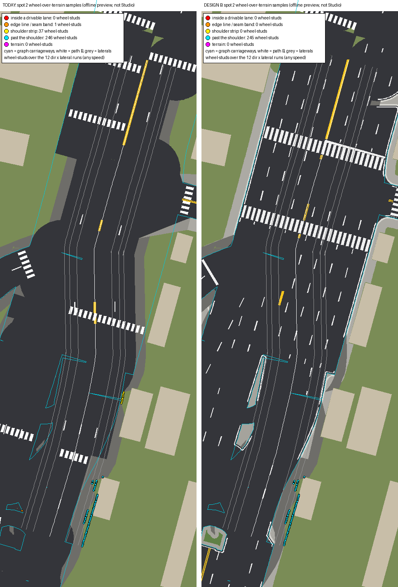
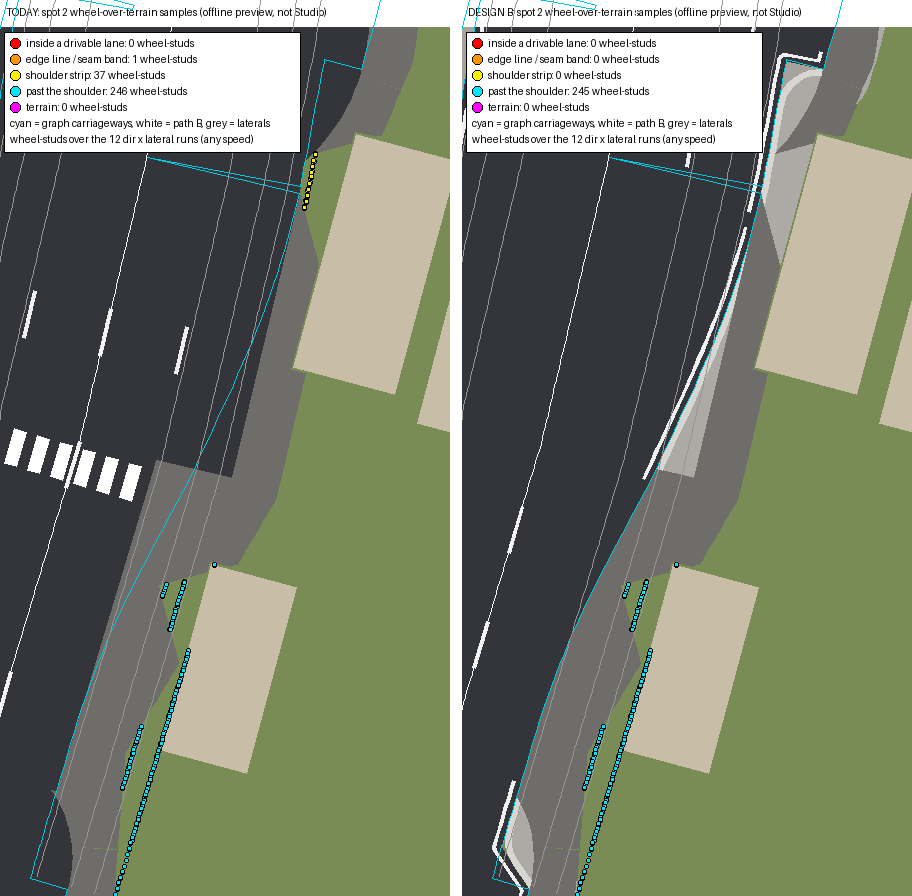
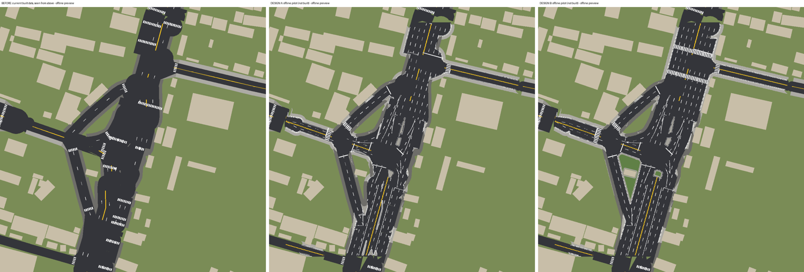
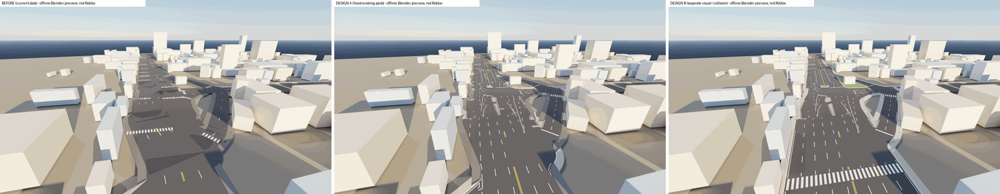
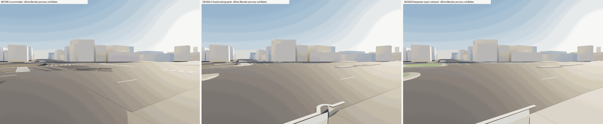
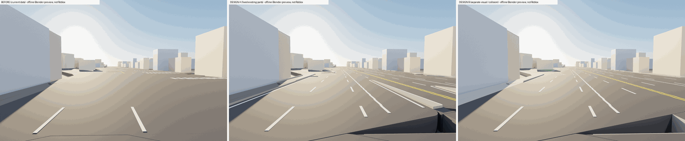
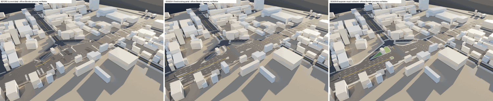
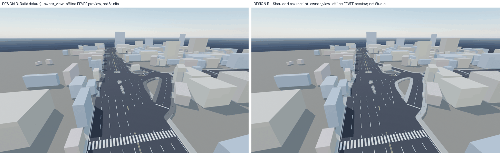

# Road B: FINAL owner review (Sukhumvit / Pattaya Klang junction, world x 24220..24820, z 650..1250)

**Status: FINAL REVIEW for the owner's decision. Nothing has been built in Studio, and building is NOT approved.**
Every number below comes from the offline tools (`tools/roadvis`, read only on `build/`) or from the luau CLI with stub
Roblox types. Every image is an offline preview (local Blender EEVEE render or PIL raster), not a Studio capture, and
none of it is a Visual PASS.

**Update 2026-10-22, after the Studio build.** Road B is built in the place (Studio: 7 cells, 1,822 parts, 782 parts
moved). The replace list is **782, not 804**: the exporter now takes the zebra bars from the built furniture modules
(`build/furniture/roblox`, 133 in the box) instead of the stale `furniture.json` (155). The 7 cell modules are
unchanged. `RV.Probe` now counts float32 hairline seams between wedges apart (Studio sample 220). The kerb-contact
expectation is now computed from the collision tops: 3 / 4 / 0, as Studio measured. Details and the ground pilot that
fills the trenches beside the road: [ROAD_GROUND_PILOT.md](ROAD_GROUND_PILOT.md) section 5. The sections below are
from before the build and still say 804.

Regenerate: `D:\ROBLOXRACE\.venv\Scripts\python tools\roadvis\cli.py pilot --art`, then
`tools\roadvis\shoulder_proof.py --map --md`, the four local renders (spec §10) and `tools\roadvis\cli.py compose`.
Tests: `tools\qa\tests\run_all.py` (all green: 201, of them 33 in `test_roadvis`).

## 0. Final review

### The decision asked
Approve a Studio **pilot build** of Road B at this one junction: default Parts build, **1,822 parts in 7 Atomic
cells**, **804 old road parts moved (not deleted)** to `ServerStorage.RoadVisBackup`, the shoulder pilot
(`ShoulderChunks`) untouched, the optional shoulder recolour not applied. The exact wording is in section 9.

### Proven offline
| Question | Today | Design B | Section |
|---|---|---|---|
| Spot 2 runs with a wheel over terrain (36 runs) | 15 | **12**; every run has the same or fewer drop samples | 1 |
| **Spot 2 drops inside a drivable lane** | **0** (0 runs, 0 wheel samples) | **0** (0 runs, 0 wheel samples) | 1 |
| Where the spot 2 drops are | past the shoulder 246 wheel-studs, shoulder strip 37, edge line 1 | past the shoulder 245 only (behind the shoulder strip, next to two buildings) | 1 |
| Spot 2 minimum up (static) | 0.916 | 0.916 | 1, 6 |
| Lane wheels over terrain, every lane of every carriageway, outside the 40-stud seam band | 250 of 3,253 | **0 of 3,253** | 4 |
| Same inside the seam band | 45 of 618 | 18 of 618, every one also a hole today | 1.4 |
| Shoulder parts moved, hidden or changed | | **0** (replace list and luau mock) | 3.5 |
| Shoulder edges that drop 3 studs to terrain | 1,980 studs | **1,308 studs** | 6 |
| Parts per Atomic cell (cap 600) | | max **570** (7 cells) | 3.1 |
| Move then Remove (luau CLI) | | **804 moved, 804 of 804 restored**, exact parent and all 12 CFrame components | 3.3 |
| Invisible wheel supports | | 129 `RoadSupport` parts: Transparency 1, CanCollide / CanQuery true, CanTouch false; 0 under a kerb, 0 on a shoulder piece, max 1.81 studs from the visible asphalt | 3.4 |

### Still needs Studio (cannot be proven offline)
1. `RV.Plan()` says `MATCHES the data` against the real place (804). The luau CLI ran it on a mock tree only.
2. `RV.Probe()` with real raycasts: 0 drops at every offset, kerb contacts about 3 / 15 / 20 (section 4). The CLI stub
   has no raycast engine, so its probe reads "drop" everywhere; it only proves the probe runs.
3. **The 72 shoulder-harness physics drives** (2 spots × 2 directions × ±24 / ±20 / ±14 × 100 / 150 / 200). Pass:
   0 flips, min up ≥ 0.71 (today's Studio result).
4. Physics drives through every open direction of the junction, GPS route, 2 minutes of traffic, a Street Challenge
   with checkpoints in the junction.
5. Captures from the owner's camera with Studio focused, and frame times with Studio focused.
6. A rollback rehearsal: `RV.Remove()` gives `restored 804 of 804`.

### Risks
- **Static model, not physics.** The offline gate is a static proxy (wheel heights, plane up-vector). On today's
  geometry it finds drops in runs that Studio drove with 0 flips. It shows "B is not worse than today", not "no flips".
- At ±20 the static up is 0.953 with B against 0.967 today, for 2 studs: the inner front wheel meets B's new kerb at the
  end of the strip while the outer rear wheel is over terrain (same drop as today).
- The drops past the shoulder at ±20 / ±24 stay (same stretches as today). Fixing them means paving between the shoulder
  strip and two building faces, which B does not do (section 1.3).
- 18 lane-wheel samples in the 40-stud seam band at the area edge are holes, inherited from today (section 1.4).
- Net +1,018 parts in workspace (1,822 new, 804 moved to ServerStorage). No QARunner cap or reference changes (section 5).
- New kerbs where today there are bare edges: 0.6-stud steps instead of 3-stud drops; physics drives must confirm.
- Furniture placed against the old kerbs may stand on new sidewalk edges until furniture.py reruns.
- Offline previews use flat colours; Roblox lighting and materials look different. The Studio capture is what counts.

### Rollback
`RV.ShoulderLookRevert()` (only if the look was applied), then `RV.Remove()`: the pilot folder is destroyed and the
804 parts go back to their exact parents and CFrames (`restored 804 of 804`; the backup is KEPT if any parent is gone).
`RV.Plan()` then shows `pilot built: false; backup present: false`. Version history is the last resort. Section 7.

## 1. Spot 2 wheel drops: B 12 of 36 runs, today 15 of 36, one row per run

### 1.1 How it is measured
- **Runs:** the Studio harness geometry for flip spot 2, path B (world (24596.6, 653.5) … (24517.5, 1038.6),
  docs/ROAD_SHOULDERS.md), forward and reverse, TestKit lateral ±24 / ±20 / ±14 (+ = right of travel), 100 / 150 / 200
  studs/s. That is 36 runs.
- **Wheels:** RaceCarServer's 4 contacts, ±3.4 lateral, ±5.2 longitudinal. RL / RR / FL / FR = rear / front, left /
  right of travel. Every 1 stud of path each contact reads the collision top; "over terrain" means nothing collides there
  (terrain at −2).
- **Speed:** static geometry is the same at every speed, so the three speeds give identical rows. They are listed
  anyway, one row per run, as asked.
- **Where:** classed against the road graph's carriageways (both carriageways of every road, the lanes GPS / traffic /
  checkpoints use). B keeps the graph lane widths, so today and B share the same carriageways.

| Class | Definition |
|---|---|
| inside a drivable lane | more than 1.2 studs inside a carriageway edge (between the lane lines; B paints its edge line 1.2 inside the kerb) |
| edge line or seam band | −1.2 … +1.0 studs about the carriageway edge, or within 40 studs of the pilot-area edge |
| shoulder strip | between the carriageway edge and the outer edge of the shoulder pieces, on the ray from the carriageway through the wheel: a gap in the strip |
| past the shoulder | up to 10 studs beyond the outer edge of the shoulder strip |
| terrain | anything else |

- **Drop height:** from the surface the wheel left (shoulder 0.985, old asphalt 0.99–1.0, B sidewalk 1.6) down to the
  terrain at −2. **Length:** studs of path with at least one wheel over terrain / the longest single-wheel stretch.
  **Up:** the static up-vector Y of the plane through the 4 contacts (1 = level). **Building samples:** a wheel inside a
  building footprint (the harness path offset 24 studs reaches a building corner; the same in both states).

### 1.2 The answer: drops inside a drivable lane
**B: 0 runs, 0 wheel samples. Today: 0 runs, 0 wheel samples.** No spot 2 drop, with B or today, happens inside a
drivable lane. So there is no in-lane fix to make here.

- **B (12 runs):** every drop is **past the shoulder**: 4.8–14.4 studs beyond the carriageway edge, behind the shoulder
  strip, in the terrain between the strip and two buildings (world x 24544–24561, z 990–1045). The same stretches
  exist today.
- **Today (15 runs):** the same past-the-shoulder stretches, plus 37 wheel-studs on the **shoulder strip** at world
  (24576.5, 926) (a gap between the road edge and a taper piece, fwd −24 / rev +24), plus 1 on the **edge line** at
  world (24495.3, 1017.1) (a notch at a trunk_link edge, rev −24). B covers both: its kerbed sidewalk and asphalt fill
  the gap and the notch. **These two fixes are in the B data.**

| State | Dir | Lateral | Speed | Wheels down | Where (wheel-studs) | Drop height | Length (studs of path / longest) | Min up | Building samples |
|---|---|---|---|---|---|---|---|---|---|
| today | fwd | -24 | 100 | RL+RR+FL+FR | shoulder strip 19, past the shoulder 82 | 2.990 | 66 / 43 | 0.916 | 25 |
| today | fwd | -24 | 150 | RL+RR+FL+FR | shoulder strip 19, past the shoulder 82 | 2.990 | 66 / 43 | 0.916 | 25 |
| today | fwd | -24 | 200 | RL+RR+FL+FR | shoulder strip 19, past the shoulder 82 | 2.990 | 66 / 43 | 0.916 | 25 |
| today | fwd | -20 | 100 | RL+FL | past the shoulder 40 | 2.985 | 40 / 11 | 0.967 | 0 |
| today | fwd | -20 | 150 | RL+FL | past the shoulder 40 | 2.985 | 40 / 11 | 0.967 | 0 |
| today | fwd | -20 | 200 | RL+FL | past the shoulder 40 | 2.985 | 40 / 11 | 0.967 | 0 |
| today | rev | +24 | 100 | RL+RR+FL+FR | shoulder strip 18, past the shoulder 84 | 2.990 | 66 / 44 | 0.916 | 25 |
| today | rev | +24 | 150 | RL+RR+FL+FR | shoulder strip 18, past the shoulder 84 | 2.990 | 66 / 44 | 0.916 | 25 |
| today | rev | +24 | 200 | RL+RR+FL+FR | shoulder strip 18, past the shoulder 84 | 2.990 | 66 / 44 | 0.916 | 25 |
| today | rev | -24 | 100 | FL | edge line 1 | 3.000 | 1 / 1 | 0.967 | 0 |
| today | rev | -24 | 150 | FL | edge line 1 | 3.000 | 1 / 1 | 0.967 | 0 |
| today | rev | -24 | 200 | FL | edge line 1 | 3.000 | 1 / 1 | 0.967 | 0 |
| today | rev | +20 | 100 | RR+FR | past the shoulder 40 | 2.985 | 40 / 11 | 0.967 | 0 |
| today | rev | +20 | 150 | RR+FR | past the shoulder 40 | 2.985 | 40 / 11 | 0.967 | 0 |
| today | rev | +20 | 200 | RR+FR | past the shoulder 40 | 2.985 | 40 / 11 | 0.967 | 0 |
| B | fwd | -24 | 100 | RL+RR+FL+FR | past the shoulder 82 | 2.985 | 47 / 43 | 0.916 | 25 |
| B | fwd | -24 | 150 | RL+RR+FL+FR | past the shoulder 82 | 2.985 | 47 / 43 | 0.916 | 25 |
| B | fwd | -24 | 200 | RL+RR+FL+FR | past the shoulder 82 | 2.985 | 47 / 43 | 0.916 | 25 |
| B | fwd | -20 | 100 | RL+FL | past the shoulder 40 | 2.985 | 40 / 11 | 0.953 | 0 |
| B | fwd | -20 | 150 | RL+FL | past the shoulder 40 | 2.985 | 40 / 11 | 0.953 | 0 |
| B | fwd | -20 | 200 | RL+FL | past the shoulder 40 | 2.985 | 40 / 11 | 0.953 | 0 |
| B | rev | +24 | 100 | RL+RR+FL+FR | past the shoulder 83 | 3.600 * | 48 / 43 | 0.916 | 25 |
| B | rev | +24 | 150 | RL+RR+FL+FR | past the shoulder 83 | 3.600 * | 48 / 43 | 0.916 | 25 |
| B | rev | +24 | 200 | RL+RR+FL+FR | past the shoulder 83 | 3.600 * | 48 / 43 | 0.916 | 25 |
| B | rev | +20 | 100 | RR+FR | past the shoulder 40 | 2.985 | 40 / 11 | 0.953 | 0 |
| B | rev | +20 | 150 | RR+FR | past the shoulder 40 | 2.985 | 40 / 11 | 0.953 | 0 |
| B | rev | +20 | 200 | RR+FR | past the shoulder 40 | 2.985 | 40 / 11 | 0.953 | 0 |

\* On the first sample of the reversed path the RR wheel stands on B's new sidewalk (1.6) and is over terrain from the
next sample on (today it is over terrain from the first sample). Every other B drop leaves the shoulder at 0.985.

Every stretch of one wheel (identical at every speed; "off the carriageway edge" in studs):

| State | Dir | Lateral | Wheel | Path s | Length | Where | Off the carriageway edge | From surface -> drop | Min up | World (x, z) |
|---|---|---|---|---|---|---|---|---|---|---|
| today | fwd | -24 | FL | 258 | 10 | shoulder strip | 1.4 .. 1.5 | 0.990 -> 2.990 | 0.967 | (24576.7, 925.4) |
| today | fwd | -24 | RL | 268 | 9 | shoulder strip | 1.4 .. 1.5 | 0.990 -> 2.990 | 0.967 | (24576.6, 926.2) |
| today | fwd | -24 | FR | 331 | 3 | past the shoulder | 4.8 .. 5.2 | 0.985 -> 2.985 | 0.955 | (24552.4, 994.0) |
| today | fwd | -24 | RL | 336 | 1 | past the shoulder | 10.4 .. 10.4 | 0.985 -> 2.985 | 0.972 | (24560.7, 989.9) |
| today | fwd | -24 | FL | 341 | 43 | past the shoulder | 8.0 .. 14.4 | n/a (next to a building) | 0.916 | (24550.3, 1024.7) |
| today | fwd | -24 | RR | 342 | 2 | past the shoulder | 4.9 .. 5.1 | 0.985 -> 2.985 | 0.996 | (24552.5, 993.6) |
| today | fwd | -24 | RL | 351 | 33 | past the shoulder | 13.1 .. 14.4 | n/a (next to a building) | 0.916 | (24551.8, 1019.5) |
| today | fwd | -20 | FL | 330 | 9 | past the shoulder | 7.4 .. 8.7 | 0.985 -> 2.985 | 0.967 | (24554.5, 996.7) |
| today | fwd | -20 | RL | 340 | 9 | past the shoulder | 7.3 .. 8.7 | 0.985 -> 2.985 | 0.967 | (24554.6, 996.4) |
| today | fwd | -20 | FL | 355 | 11 | past the shoulder | 10.4 .. 10.4 | 0.985 -> 2.985 | 0.967 | (24547.0, 1021.6) |
| today | fwd | -20 | RL | 366 | 11 | past the shoulder | 10.4 .. 10.4 | 0.985 -> 2.985 | 0.967 | (24546.8, 1022.2) |
| today | rev | +24 | FR | 0 | 34 | past the shoulder | 13.1 .. 14.4 | n/a (path start) | 0.916 | (24551.6, 1020.4) |
| today | rev | +24 | RR | 0 | 44 | past the shoulder | 7.9 .. 14.4 | n/a (path start) | 0.916 | (24550.0, 1025.6) |
| today | rev | +24 | FL | 41 | 2 | past the shoulder | 4.9 .. 5.1 | 0.985 -> 2.985 | 0.996 | (24552.2, 994.5) |
| today | rev | +24 | FR | 48 | 1 | past the shoulder | 10.4 .. 10.4 | 0.985 -> 2.985 | 0.972 | (24560.8, 989.8) |
| today | rev | +24 | RL | 51 | 3 | past the shoulder | 4.8 .. 5.1 | 0.985 -> 2.985 | 0.955 | (24552.4, 994.0) |
| today | rev | +24 | FR | 108 | 8 | shoulder strip | 1.4 .. 1.5 | 0.985 -> 2.985 | 0.967 | (24576.4, 927.1) |
| today | rev | +24 | RR | 117 | 10 | shoulder strip | 1.4 .. 1.5 | 0.990 -> 2.990 | 0.967 | (24576.5, 926.3) |
| today | rev | -24 | FL | 3 | 1 | edge line | 0.0 .. 0.0 | 1.000 -> 3.000 | 0.967 | (24495.3, 1017.1) |
| today | rev | +20 | FR | 8 | 11 | past the shoulder | 10.4 .. 10.4 | 0.985 -> 2.985 | 0.967 | (24546.9, 1022.1) |
| today | rev | +20 | RR | 19 | 11 | past the shoulder | 10.4 .. 10.4 | 0.985 -> 2.985 | 0.967 | (24547.0, 1021.6) |
| today | rev | +20 | FR | 36 | 9 | past the shoulder | 7.3 .. 8.7 | 0.985 -> 2.985 | 0.967 | (24554.6, 996.3) |
| today | rev | +20 | RR | 46 | 9 | past the shoulder | 7.4 .. 8.7 | 0.985 -> 2.985 | 0.967 | (24554.5, 996.7) |
| B | fwd | -24 | FR | 331 | 3 | past the shoulder | 4.8 .. 5.2 | 0.985 -> 2.985 | 0.955 | (24552.4, 994.0) |
| B | fwd | -24 | RL | 336 | 1 | past the shoulder | 10.4 .. 10.4 | 0.985 -> 2.985 | 0.972 | (24560.7, 989.9) |
| B | fwd | -24 | FL | 341 | 43 | past the shoulder | 8.0 .. 14.4 | n/a (next to a building) | 0.916 | (24550.3, 1024.7) |
| B | fwd | -24 | RR | 342 | 2 | past the shoulder | 4.9 .. 5.1 | 0.985 -> 2.985 | 0.996 | (24552.5, 993.6) |
| B | fwd | -24 | RL | 351 | 33 | past the shoulder | 13.1 .. 14.4 | n/a (next to a building) | 0.916 | (24551.8, 1019.5) |
| B | fwd | -20 | FL | 330 | 9 | past the shoulder | 7.4 .. 8.7 | 0.985 -> 2.985 | 0.967 | (24554.5, 996.7) |
| B | fwd | -20 | RL | 340 | 9 | past the shoulder | 7.3 .. 8.7 | 0.985 -> 2.985 | 0.967 | (24554.6, 996.4) |
| B | fwd | -20 | FL | 355 | 11 | past the shoulder | 10.4 .. 10.4 | 0.985 -> 2.985 | 0.967 | (24547.0, 1021.6) |
| B | fwd | -20 | RL | 366 | 11 | past the shoulder | 10.4 .. 10.4 | 0.985 -> 2.985 | 0.953 | (24546.8, 1022.2) |
| B | rev | +24 | FR | 0 | 34 | past the shoulder | 13.1 .. 14.4 | n/a (path start) | 0.916 | (24551.6, 1020.4) |
| B | rev | +24 | RR | 1 | 43 | past the shoulder | 8.0 .. 14.4 | 1.600 -> 3.600 | 0.916 | (24550.3, 1024.6) |
| B | rev | +24 | FL | 41 | 2 | past the shoulder | 4.9 .. 5.1 | 0.985 -> 2.985 | 0.996 | (24552.2, 994.5) |
| B | rev | +24 | FR | 48 | 1 | past the shoulder | 10.4 .. 10.4 | 0.985 -> 2.985 | 0.972 | (24560.8, 989.8) |
| B | rev | +24 | RL | 51 | 3 | past the shoulder | 4.8 .. 5.1 | 0.985 -> 2.985 | 0.955 | (24552.4, 994.0) |
| B | rev | +20 | FR | 8 | 11 | past the shoulder | 10.4 .. 10.4 | 0.985 -> 2.985 | 0.953 | (24546.9, 1022.1) |
| B | rev | +20 | RR | 19 | 11 | past the shoulder | 10.4 .. 10.4 | 0.985 -> 2.985 | 0.967 | (24547.0, 1021.6) |
| B | rev | +20 | FR | 36 | 9 | past the shoulder | 7.3 .. 8.7 | 0.985 -> 2.985 | 0.967 | (24554.6, 996.3) |
| B | rev | +20 | RR | 46 | 9 | past the shoulder | 7.4 .. 8.7 | 0.985 -> 2.985 | 0.967 | (24554.5, 996.7) |

Drop map, every wheel-over-terrain sample of the 36 runs coloured by class (offline preview, not Studio):

The drop zone up close (world x 24525–24600, z 900–1045):

### 1.3 What would fix each class, and is it in the B data?
| Class | Today | B | Fix | In the B data? |
|---|---|---|---|---|
| inside a drivable lane | 0 | 0 | none needed | n/a |
| edge line | 1 (notch at a trunk_link edge) | 0 | the new asphalt covers the full carriageway | **yes** |
| shoulder strip | 37 (gap between the road edge and a taper piece) | 0 | the new kerbed sidewalk and asphalt fill the gap | **yes** |
| past the shoulder | 246 | 245 | pave (or put a flush support) between the outer edge of the shoulder strip and the two building faces at world x 24544–24561, z 990–1045 | **no**: it is outside the carriageway and outside the shoulder strip. B's sidewalks stop at the shoulder pieces by design, and the pilot rules forbid changing the shoulder pilot or adding cover-up parts. The same stretches are in today's geometry, which passed 72 Studio runs with 0 flips. An owner decision if wanted. |
| terrain | 0 | 0 | | |

An earlier version of B (e44ae12) showed fewer drops at ±20 / ±24 (31 / 44 / 46). Those came from sidewalk slivers
behind the strip (0.1–1.8 studs wide) that also raised 0.6-stud ridges between shoulder pieces; this version removes
them (section 8), so those wheel spots are back to today's state: B = today at ±20, B < today at ±24.

### 1.4 Lanes in the 40-stud seam band (area-wide lane check, not spot 2)
The lane check puts the 4 wheels on every lane centre of every carriageway every 2 studs. Outside the seam band: **0 of
3,253 samples unsupported with B** (250 today). In the band 4–50 studs from the area edge (the 40-stud seam band plus
half a car): **18 of 618 with B** (45 today), and **every one of the 18 wheel spots is also a hole today** (checked
wheel by wheel). Where: Sukhumvit (east carriageway) at world x 24617–24638, z 680–694, and Pattaya Klang Road at world
x 24254–24265, z 928–933.

- Cause: within 40 studs of the area edge the new asphalt tapers to the outline of the old road that continues
  outside the pilot, so it keeps the old road's narrower width there.
- Fix: pave those lanes at full graph width through the seam, together with the old road outside (the next junction's
  pilot), or a larger pilot area. **Not in the B data**: the old road outside is narrower, and B would end in a square
  edge at the area boundary. None of these spots is on the spot 2 path.

## 2. Before / A / B images (offline previews, NOT Studio)

**Renderer:** Blender 5.1.2 as the PyPI `bpy` module, run locally (the GPU box is paused by owner order), EEVEE,
16 samples, Nishita sky + sun, 4 render threads, 0.6 × the camera resolution. The same engine, light and cameras for
before, A and B, so the panels compare. Before = today as built. B = the default Build, which leaves the shoulder
pieces in today's colour. The owner's camera: pos (24609.8, 115.9, 713.3), look (-0.386, -0.386, 0.837), vertical FOV
70, 1831 × 1074. The top-down view is a PIL raster ("what the eye sees from straight above").

Top-down:

Owner's camera:

Street level, east kerb of Sukhumvit:

Driver chase camera, northbound:

Aerial:

Optional, only if the owner wants it: B with `ShoulderLook` (strips and tapers recoloured to gutter concrete; revert
with `ShoulderLookRevert`):

Single panels: `art/roadvis/cam_<before|A|B>_<owner_view|street|driver|aerial>.png`, `top_before.png`, `top_A.png`,
`top_B.png`, `top_before_layers.png`.

## 3. Verification of the Studio data and builder (final data, luau CLI)

`test_roadvis.LuauRoadVis` runs `PattayaRoadVisBuilder.luau` on the exported data (`build/roadvis/roblox`, 7 cell
modules + manifest) in the luau CLI with stub Roblox types, on a mock place with one part at every expected key (each
turned by its own angle about Y), decoys and two shoulder parts. Output: `build/roadvis/luau_cli_output.txt`.

### 3.1 Parts per Atomic cell (`ModelStreamingMode = Atomic`, cap 600)
| Cell | Parts | Module size |
|---|---|---|
| Cell_16_3 | 308 | 33 KB |
| Cell_16_4 | 72 | 7 KB |
| Cell_17_2 | 87 | 10 KB |
| Cell_17_3 | **570** | 54 KB |
| Cell_17_4 | 475 | 39 KB |
| Cell_18_2 | 193 | 28 KB |
| Cell_18_3 | 117 | 10 KB |
| **Total** | **1,822** (data 1,822) | every module ≤ 600 parts, ≤ 60 KB |

No cell needs the 128-stud quadrant split any more (the largest is 570).

### 3.2 Parts per kind
| Kind | Parts | Collides | Notes |
|---|---|---|---|
| asphalt | 524 | yes | visible WedgeParts, named `Road` |
| support | 129 | yes | **invisible** `RoadSupport` WedgeParts (3.4) |
| sidewalk | 510 | yes | |
| island | 142 | yes | |
| lane | 179 | no | |
| centre | 36 | no | |
| edge | 96 | no | |
| stop | 6 | no | |
| zebra | 68 | no | |
| kerb | 62 | no | |
| grass | 70 | no | |
| **Total** | **1,822** | | the CLI found no part whose collision differs from its kind |

### 3.3 Move, then Remove
| Step | Luau CLI result |
|---|---|
| `RV.Plan()` | `Road 397, Sidewalk 7, Dash 41, Centre 22, Junction 17, Joint 10, Apron 142, CornerFill 13, ZebraStripe 155 -> MATCHES the data; selected 804, expected 804; unmatched selected 0, expected but not found 0` |
| `RV.Build()` | `built 7 cells, 1822 parts (Parts)`; a second call refuses (`already exists`) |
| `RV.MoveReplaced()` | `moved 804 parts`; 804 in the backup, 0 elsewhere; the 3 decoys (outside the area, mostly outside, wrong name) and both shoulder parts stay; a second call refuses |
| `RV.Remove()` | `restored 804 of 804 parts to their original parents; backup removed` |
| After Remove | **804 of 804** in their exact original parent; **804 of 804** with all 12 CFrame components identical (position and the turned rotation) and the builder's attributes (`OriginalParent`, `OriginalCFrame`, `RoadVisMoved`) gone, the parts' own attributes kept; `RoadVisPilot` and `RoadVisBackup` gone |
| One expected part missing | `ABORTED, nothing moved` |

### 3.4 Invisible wheel supports
They hold a wheel where an old replaced road part did, within 2 studs of the new asphalt, where B puts no kerb,
sidewalk or island and no shoulder piece already carries the wheel.

| Item | Value |
|---|---|
| Parts | **129** WedgeParts (68 triangles), named `RoadSupport` |
| Area | 123.8 studs² |
| Properties (all 129, read from the built parts in the CLI) | **Transparency 1, CanCollide true, CanQuery true** (the raycast suspension must see them), **CanTouch false**; top at 1.000, flush with the asphalt |
| Under a kerb, sidewalk or island (visual or collision) | **0.0 studs²** |
| On or under a ShoulderChunks part | **0.0 studs²** |
| Largest distance of a support corner from the visible asphalt | **1.81 studs** (rule ≤ 2) |
| Cross-check | the test rebuilds the footprints of the 129 parts the CLI built and checks the same three rules against the Python data |

| Patch (world centroid) | Area (studs²) | Parts | Cell |
|---|---|---|---|
| (24220.7, 919.9) | 23.5 | 24 | Cell_16_3 |
| (24230.8, 878.7) | 33.6 | 27 | Cell_16_3 |
| (24376.4, 1245.1) | 33.6 | 49 | Cell_17_4 |
| (24380.9, 1236.4) | 0.3 | 2 | Cell_17_4 |
| (24468.1, 853.8) | 22.6 | 9 | Cell_17_3 |
| (24816.7, 824.0) | 10.3 | 18 | Cell_18_3 |

### 3.5 ShoulderChunks untouched
- The replace list (804 parts) holds **0** shoulder pieces (`shoulder_proof.untouched`; 1,002 shoulder pieces loaded).
- `MoveReplaced` looks only in WideChunks, Chunks, WideJunctions, Junctions, ApronChunks and FurnitureChunks, under road
  part names, skips anything in `ShoulderChunks` or with the `Shoulder` attribute, and checks again before moving.
- In the CLI: a part named `Road` inside `ShoulderChunks` is never selected. Both shoulder parts keep parent, colour,
  material, transparency, CanCollide and position after Build + Move and after Remove
  (`SHOULDERS_AFTER_BUILD_MOVE true`, `SHOULDERS_AFTER_REMOVE true`), and `ShoulderChunks` keeps the same number of
  descendants (3 → 3 → 3).
- `Build` creates parts only under `RoadVisPilot`; a source test allows `:Destroy()` only on the pilot and the backup.
- `ShoulderLook` is opt-in, keeps CanCollide and CanQuery, and its revert is tested.

## 4. Geometry QA (offline, design B)

**Probe expectations** (what `RV.Probe()` should report in Studio): 680 lane-centre samples on 31 legs, outside the
50-stud seam band, a 4 × 9 car footprint (6 points) at each offset, counted where the offset lies on the carriageway.

| Offset | Samples | Drop (wheel over terrain) | Kerb contact (0.45–0.6 step up) |
|---|---|---|---|
| 0 | 680 | **0** | 0 |
| ±8 | 625 / 625 | **0** | 0 |
| ±14 | 216 / 216 | **0** | 0 |
| +20 / −20 | 123 / 123 | **0** | 0 / 3 |
| +24 / −24 | 118 / 118 | **0** | 15 / 20 |

| Check | Before | B |
|---|---|---|
| Lane wheels on every lane of every carriageway, outside the seam band | 250 of 3,253 unsupported | **0 of 3,253** |
| Same, including the 40-stud seam band | 295 of 3,871 | 18 of 3,871 (section 1.4) |
| Pilot parts or sidewalks overlapping a building | | **0.0 studs²** |
| Visible asphalt without collision under it | | **0.0 studs²** |
| Collision outside the visible surface (supports not counted) | | 18.5 studs² |
| Asphalt outside every lane corridor and junction | 470 | **0.0** |
| Zebras that reach a sidewalk or island at both ends | 0 of 18 | **4 of 4**: Pattaya Klang 41 studs, Sukhumvit 109 and 104, Soi 53 26; all perpendicular to their leg |
| Lane / centre / edge markings inside the junction polygon (19,857 studs²) | | **0.0 studs²** |
| Lane-boundary coverage outside the junction polygon | 45.8 % | 99.3 % |

## 5. Instance budget

| | Parts |
|---|---|
| Old parts `MoveReplaced` moves to `ServerStorage.RoadVisBackup` | **804**: Road 397, Sidewalk 7, Dash 41, Centre 22, Junction 17, Joint 10, Apron 142, CornerFill 13, ZebraStripe 155 |
| After, default Parts build | **1,822** in 7 Atomic cells (3.1, 3.2) |
| After, mesh build (`Build({mesh = true})`) | 1,359 (1,317 invisible collision wedges incl. the 129 supports, + 42 MeshParts). It needs the tile meshes uploaded as assets, which is **not approved**. |
| Shoulder pilot parts in the area (unchanged) | 1,601 |

**QA runner (`PattayaQARunner.luau`, not changed):**

| Item | Reference / cap | Change with B |
|---|---|---|
| `PART_REFS` WideChunks | 37,800 (warn above 47,250) | −467 |
| `PART_REFS` ApronChunks | 23,791 (warn above 29,738) | −155 |
| `PART_REFS` FurnitureChunks | 9,246 (warn above 11,557) | −155 |
| WideJunctions (no reference) | | −27 |
| RoadVisPilot (no reference) | | **+1,822** (INFO line only) |
| ShoulderChunks | 2,536 | 0 |
| `TOTAL_PARTS_WARN` | 160,000 | **+1,018** net in workspace (the 804 backed-up parts sit in ServerStorage, which the runner does not count) |
| `CHUNK_CAPS` | no entry for RoadVisPilot | every cell ≤ 600, so a future `RoadVisPilot = 600` cap would pass |

No QARunner cap or reference has to change for the pilot. If it is accepted, `["PattayaWorld.RoadVisPilot"] = 1822`
in `PART_REFS` and `RoadVisPilot = 600` in `CHUNK_CAPS` would make it visible. **Not done here.**

## 6. The shoulder pilot still carries the wheels with B (offline)

### 6.1 Where B meets the shoulders
Every edge of the 871 shoulder / taper / gap pieces in the area, sampled every 1 stud; the collision top read 0.1 stud
outside the edge.

| Edge class (studs of shoulder edge) | Today | With B |
|---|---|---|
| Flush (road-height neighbour, step ≤ 0.02) | 3,165 | **3,247** (largest step 0.015) |
| Kerb (step **up** about 0.6 to a sidewalk / island face, no drop) | 21 | 612 (largest 0.615) |
| Ridge (a raised sliver with another shoulder piece within 1 stud behind it) | 0 | 3 |
| Drop (terrain, 3 studs down) | 1,980 | **1,308** |
| Slot (nothing at 0.1, a surface within 1 stud) | 151 | **147** |
| Between two shoulder pieces | 1,666 | 1,666 |

| Overlap | Area |
|---|---|
| B sidewalk / island collision on a shoulder piece | **0.0 studs²** |
| B visual sidewalk on a shoulder piece | **0.0 studs²** |
| B asphalt on a shoulder piece | 2,977 studs², 1.5 cm above it (1.000 vs 0.985); both collide, the asphalt hides the shoulder. The only overlap, and flush. |

### 6.2 Drive gate summary (36 runs; per-run detail in section 1)
| Dir | Lateral | Today: drops / min up | With B: drops / min up | B kerb samples | Building samples (today / B) |
|---|---|---|---|---|---|
| fwd | +24 | 0 / 1.000 | 0 / 0.998 | 81 | 0 / 0 |
| fwd | −24 | 66 / 0.916 | **47** / 0.916 | 40 | 25 / 25 |
| fwd | +20 | 0 / 1.000 | 0 / 0.999 | 16 | 0 / 0 |
| fwd | −20 | 40 / 0.967 | 40 / 0.953 | 34 | 0 / 0 |
| fwd | +14 | 0 / 1.000 | 0 / 1.000 | 0 | 0 / 0 |
| fwd | −14 | 0 / 1.000 | 0 / 0.999 | 6 | 0 / 0 |
| rev | +24 | 66 / 0.916 | **48** / 0.916 | 39 | 25 / 25 |
| rev | −24 | 1 / 0.967 | **0** / 0.998 | 81 | 0 / 0 |
| rev | +20 | 40 / 0.967 | 40 / 0.953 | 34 | 0 / 0 |
| rev | −20 | 0 / 1.000 | 0 / 0.999 | 15 | 0 / 0 |
| rev | +14 | 0 / 1.000 | 0 / 0.999 | 6 | 0 / 0 |
| rev | −14 | 0 / 1.000 | 0 / 1.000 | 0 | 0 / 0 |

Same rows at 100, 150 and 200 studs/s. Minimum up 0.916 in both states. Spot 1 (25250, 13430) lies outside the pilot
area: B does not change it, and its Studio result stands. **The final proof needs the 72 physics drives in Studio.**

## 7. Rollback

| Step | Command | Expected |
|---|---|---|
| 1 | `RV.ShoulderLookRevert()` (only if the optional shoulder look was applied) | every changed shoulder part gets its original Color / Material / Transparency back from its `RVOrig*` attributes |
| 2 | `RV.Remove()` | `RoadVisPilot` destroyed; **`restored 804 of 804`**, each part to its exact original parent and CFrame; backup folder removed. If any original parent is missing, the backup is KEPT and the message says so. |
| 3 | `RV.Plan()` | `pilot built: false; backup present: false`; the move plan `MATCHES the data` again |
| 4 | File > version history | last resort: the place version saved just before the build |

| Item | Where during a pilot |
|---|---|
| Builder | `ServerStorage.PattayaRoadVisBuilder` |
| Data | `ServerStorage.PattayaDataRoadVis` (manifest + 7 cell modules) |
| New road | `workspace.PattayaWorld.RoadVisPilot.Cell_*` (7 Atomic Models) |
| Moved old parts | `ServerStorage.RoadVisBackup`: one Folder per original parent with an ObjectValue `OriginalParentRef`; each part carries `OriginalParent` (path), `OriginalCFrame` and `RoadVisMoved`; folder attribute `Count` = 804 |
| Optional shoulder look | attributes `RVOrigColor`, `RVOrigMaterial`, `RVOrigTransparency` on the shoulder parts it touched; nothing else |

## 8. What changed in the B data in this round (since e44ae12)

| Change | Why | Effect |
|---|---|---|
| The invisible wheel support is its own parts: `RoadSupport`, Transparency 1, CanCollide / CanQuery true, CanTouch false | in e44ae12 it was merged into the visible asphalt, so it was not invisible in the Parts build | 129 parts, 3.4 |
| Sidewalk / island collision keeps the exact visual edge beside a shoulder piece | its 0.25-stud simplification opened 0.1–0.2-stud slots against shoulder pieces (one sample at rev +24) | slot 162 → 147 (today 151) |
| Sidewalks and islands stay out of the joints between shoulder pieces (pieces closed by 1 stud) | 403 studs of shoulder edge faced a raised 0.6 sliver between two flush pieces: a wheel bump | ridge 403 → 3; joints stay as today |
| Sidewalk pieces that no longer touch the asphalt or an island are dropped | 5 slivers 0.1–1.8 studs wide behind the strip | terrain there, as today |
| Supports keep the exact edge against shoulder pieces | no slot between a support and a shoulder | |

Parts 1,935 → **1,822** (sidewalk 710 → 510, island 144 → 142, kerb 64 → 62, edge 108 → 96, asphalt 550 → 524 visible
+ 129 invisible supports); cells 10 → **7**.

## 9. Studio acceptance (after approval) and the approval request

**Procedure** (spec §9 has every command and expected output):
1. Save the place and confirm the version-history entry.
2. Put in the builder and the 7 data modules + manifest.
3. `RV.Plan()`: it must say `MATCHES the data` (804). If not, stop.
4. `RV.Build()`: 7 cells, 1,822 parts.
5. `RV.MoveReplaced()`: 804 moved.
6. `RV.Probe()`: 0 drops at every offset, kerb contacts about 3 / 15 / 20.
7. Captures from the owner's camera with Studio focused.
8. Play mode, physics: the shoulder harness (2 spots × 2 directions × ±24 / ±20 / ±14 × 100 / 150 / 200; pass: 0
   flips, min up ≥ 0.71), then every open direction of the junction on every lane.
9. GPS route through the junction, traffic loops for 2 minutes, a Street Challenge with checkpoints in the junction.
10. Frame times with Studio focused.
11. Rollback rehearsal: `Remove()` gives 804 of 804, then `Build()` + `MoveReplaced()` again if the owner keeps it.

**Approval request (exact wording for the owner):**

> I approve a Studio PILOT BUILD of Road B at the Sukhumvit / Pattaya Klang junction (world x 24220..24820,
> z 650..1250) on a freshly saved place version, with the default Parts build (1,822 parts in 7 Atomic cells, 129 of
> them invisible wheel supports). 804 old road parts in that area are moved, not deleted, to
> ServerStorage.RoadVisBackup. The road graph, GPS, traffic data, physics and the shoulder pilot (ShoulderChunks) stay
> unchanged, and the optional shoulder recolour is NOT applied. Acceptance needs: 0 flips in the 72 shoulder-harness
> physics drives (min up ≥ 0.71), Probe 0 drops, and captures from my screenshot camera with Studio focused. Any
> failure means RV.Remove() (804/804 restored). Mesh assets are not approved.

## 10. Root cause (summary)

Full report: [ROAD_VISUAL_ROOT_CAUSE.md](ROAD_VISUAL_ROOT_CAUSE.md). Spec and the A vs B comparison:
[ROAD_VISUAL_SPEC.md](ROAD_VISUAL_SPEC.md).

| # | Cause | Number at this junction |
|---|---|---|
| 1 | City at ×0.5, lanes and car at ×1: roads take 2.08× their real share | carriageway-on-carriageway overlap 12,188 studs² |
| 2 | Dual carriageways merged by moving one slab onto the median | 250 of 3,253 lane samples over terrain; 360 fill triangles |
| 3 | Junction discs | 38 % of the disc area sticks out past the slabs |
| 4 | What you see is what you drive on: every collision patch is visible | 25.7 % of the asphalt is stacked 2+ surfaces deep |
| 5 | Markings and zebras made per edge | lane-line coverage 46 %; 0 of 18 zebras reach a sidewalk at both ends |
| 6 | Sukhumvit has no sidewalk; the shoulder pilot outlines the ragged edge | 227 shoulder strips visible in the owner's view |

Design B builds both carriageways from the road graph (the graph is unchanged), uses junction polygons with no discs,
adds kerbed sidewalks and islands, draws markings per carriageway, and puts zebras only on legs.
